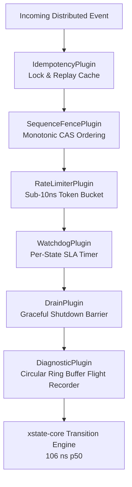

<div align="center">

<a href="https://basiltt.github.io/xstate-statemachine-rs/">
<picture>
  <source media="(max-width: 640px)" srcset="docs/assets/images/readme-hero-mobile.svg">
  
</picture>
</a>

# xstate-statemachine

**State machines & visual statecharts for Rust — fast, zero-allocation, unbreakable.**

[](https://crates.io/crates/xstate-statemachine)
[](https://docs.rs/xstate-statemachine)
[](https://basiltt.github.io/xstate-statemachine-rs/)
[](https://github.com/basiltt/xstate-statemachine-rs/actions/workflows/ci.yml)
[](Cargo.toml)
[](#-hard-performance-benchmarks)
[](https://stately.ai/docs/xstate)
[](LICENSE)

```bash
cargo add xstate-statemachine
```

**106 ns transitions · 0 steady-state heap allocations · 100% XState v5 spec parity · 15 modular workspace crates**

[60-Second Quickstart](#-60-second-quickstart) · [The Pain of Naive Enums](#-the-problem-the-rust-enum-trap) · [Visual Stately Workflow](#-visual-statecharts-with-stately-studio) · [Production Plugins](#-production-resilience-plugins) · [Competitor Matrix](#-how-it-compares) · [Performance](#-hard-performance-benchmarks) · [Ecosystem](#-ecosystem-integrations) · [Full Documentation Book ↗](https://basiltt.github.io/xstate-statemachine-rs/)

</div>

---

## ⚡ 60-Second Quickstart

Try it right now in your project with zero boilerplate.

### 1. Compile-Time Checked Rust DSL (`statechart!`)

Prefer pure, type-safe Rust with instant auto-complete and zero JSON parsing?

```toml
[dependencies]
xstate-statemachine = { version = "0.1", features = ["macros"] }
```

```rust
use xstate_statemachine::prelude::*;
use xstate_statemachine::macros::statechart;

fn main() -> Result<(), xstate_statemachine::core::Error> {
    // 1. Declare statechart with compile-time checked transitions
    let machine = statechart! {
        id: "traffic_light",
        initial: Green,
        states: {
            Green  { on: { TIMER: Yellow } },
            Yellow { on: { TIMER: Red } },
            Red    { on: { TIMER: Green } }
        }
    };

    // 2. Drive with the zero-allocation synchronous interpreter (106 ns/step)
    let mut light = SyncInterpreter::new(machine, MachineLogic::dynamic());
    light.start()?;

    let receipt = light.send("TIMER")?;
    assert_eq!(receipt.state_ids(), ["traffic_light.Yellow"]);

    // Unregistered transitions are safely rejected with zero side-effects
    let unhandled = light.send("INVALID")?;
    assert!(unhandled.unhandled);

    Ok(())
}
```

---

### 2. Run Visual XState JSON & Stately Studio Models

Export directly from [Stately Studio](https://stately.ai/editor) or author in JSON. Run unmodified in Rust:

```rust
use xstate_statemachine::prelude::*;

fn main() -> Result<(), xstate_statemachine::core::Error> {
    let machine = Machine::from_json(r#"{
        "id": "door",
        "initial": "closed",
        "context": {"opens": 0, "locked": false},
        "states": {
            "closed": {
                "on": {
                    "OPEN": {
                        "target": "opened",
                        "guard": "isUnlocked",
                        "actions": "countOpen"
                    }
                }
            },
            "opened": {"on": {"CLOSE": "closed"}}
        }
    }"#)?;

    // Bind typed Rust business logic closures
    let logic = MachineLogic::dynamic()
        .guard("isUnlocked", |ctx, _event, _params| {
            Ok(ctx["locked"] != true)
        })
        .action("countOpen", |scope| {
            let n = scope.context["opens"].as_u64().unwrap_or(0) + 1;
            scope.context["opens"] = n.into();
            Ok(())
        });

    let mut door = SyncInterpreter::new(machine, logic);
    door.start()?;

    let receipt = door.send("OPEN")?;
    assert_eq!(receipt.state_ids(), ["door.opened"]);
    assert_eq!(door.context()["opens"], 1);

    Ok(())
}
```

---

### 3. Concurrent Tokio Actor with Precision Timers & Backpressure

Need non-blocking actor execution, bounded channels, and automatic timer cancellation?

```toml
[dependencies]
xstate-statemachine = { version = "0.1", features = ["tokio"] }
```

```rust
use xstate_statemachine::prelude::*;
use xstate_statemachine::tokio::{spawn, Options};

#[tokio::main]
async fn main() -> Result<(), Box<dyn std::error::Error>> {
    let machine = Machine::from_json(r#"{
        "id": "order_checkout",
        "initial": "awaiting_payment",
        "states": {
            "awaiting_payment": {
                "after": {"30000": "expired"},
                "on": {"PAYMENT_RECEIVED": "fulfilled", "CANCEL": "cancelled"}
            },
            "fulfilled": {"type": "final"},
            "cancelled": {"type": "final"},
            "expired":   {"type": "final"}
        }
    }"#)?;

    // Spawn an isolated Tokio actor with bounded mailbox and timer supervisor
    let actor = spawn(machine, MachineLogic::dynamic(), Options::default())?;

    // Send async event and await transition receipt
    let receipt = actor.send_and_wait("PAYMENT_RECEIVED").await?;
    assert_eq!(receipt.state_ids(), ["order_checkout.fulfilled"]);

    actor.stop().await;
    Ok(())
}
```

---

## 🧠 The Problem: The Rust "Enum Trap"

Rust developers love `enum` and `match`. The compiler forces exhaustive pattern matching, giving a strong sense of safety.

**Until your system scales.**

When workflows expand into real-world distributed production systems, hand-rolled enums inevitably collapse into anti-patterns:

```rust
// ❌ THE ANTI-PATTERN: Boolean Flag Soup & State Combinatorics
struct OrderState {
    status: OrderStatus,     // Placed, Paid, Shipped, Cancelled
    is_refunding: bool,      // What if status == Cancelled && is_refunding?
    is_retry: bool,          // What if status == Shipped && is_retry?
    is_draining: bool,       // What happens during server shutdown?
    last_event_seq: u64,     // Did an out-of-order Kafka message arrive?
    pending_tasks: usize,    // Are we leaking background tasks?
}
```

### The Inevitable Production Bugs:
1. **Impossible States Are Representable:** With just 4 statuses and 4 boolean flags, you have $4 \times 2^4 = 64$ state combinations. Over 80% of them are illegal and unhandled in your match blocks.
2. **Silent State Corruption at 3 AM:** An unhandled event arriving in an intermediate state silently falls through the default `_ => {}` arm. The client hangs, the order is lost.
3. **No Visual Truth:** Product managers, frontend engineers, and backend developers maintain separate mental models of the same workflow. Regressions creep in with every PR.
4. **Ad-Hoc Concurrency & Retries:** Every microservice reinvents timer cancellation, webhook idempotency, exponential backoff, and graceful shutdown barriers from scratch.

### The Solution: Statecharts
`xstate-statemachine-rs` brings **David Harel's mathematically proven statechart formalism** (W3C SCXML / XState v5) to high-performance Rust:
* **Compound (Hierarchical) States:** Cancel nested background tasks with a single top-level transition.
* **Parallel (Orthogonal) Regions:** Run independent sub-workflows (e.g., streaming telemetry + processing payments) simultaneously.
* **First-Class Timers (`after`):** Timers are automatically scheduled and cancelled when exiting states.
* **Zero-Allocation Execution:** 106 ns transitions with pre-allocated bitsets.

---

## 🎨 Visual Statecharts with Stately Studio

Stop guessing what your state machine does. **See it. Test it. Run it.**

You can design your workflows visually in **[Stately Studio](https://stately.ai/editor)**, export the JSON, and run it directly in Rust. Or inspect running Rust actors in real time over SSE/WebSockets using `@statelyai/inspect`:

<div align="center">
<a href="https://stately.ai/registry/editor/4dbe1227-e533-4104-9772-dd7c7b3a86df?mode=design&machineId=6938bbd2-1666-42dc-838f-542837486866">
  
</a>
<br>
<sub>🔗 <strong><a href="https://stately.ai/registry/editor/4dbe1227-e533-4104-9772-dd7c7b3a86df?mode=design&machineId=6938bbd2-1666-42dc-838f-542837486866">Click here to open and simulate this live toggle machine in Stately Studio</a></strong></sub>
</div>

### Complete Two-Way Visual Workflow:
1. **Design visually:** Use drag-and-drop statecharts in Stately Studio or the VS Code Stately extension.
2. **Execute in Rust:** Load the exported JSON via `Machine::from_json(...)` with zero overhead.
3. **Inspect live:** Connect the `xstate-inspect` module to stream real-time transition telemetry directly into Stately's visual debugger.

---

## 🛡️ Production Resilience Plugins

Rust developers frequently encounter acute distributed systems challenges where the ecosystem only offers fragile workarounds. `xstate-statemachine` provides **turnkey, zero-allocation resilience plugins** (`features = ["patterns"]`):



### 1. 🔒 Webhook & Payment Deduplication (`IdempotencyPlugin`)
Prevents double-charges and race conditions on retried HTTP webhooks (Stripe, Shopify, Adyen). Automatically drops duplicate in-flight requests and returns cached receipts for replays.

```rust
use xstate_statemachine::prelude::*;
use xstate_statemachine::plugins::IdempotencyPlugin;

let mut idempotency = IdempotencyPlugin::new(10_000); // 10k LRU cache
let key = "evt_stripe_charge_123";

// Acquire RAII lock; duplicate in-flight calls are immediately rejected
if let Some(guard) = idempotency.acquire(key) {
    let receipt = interpreter.send("PAYMENT_SUCCESS")?;
    guard.commit(receipt);
} else {
    // Already processed or currently processing!
    let cached = idempotency.get_cached_receipt(key);
}
```

### 2. 🛑 Graceful Tokio Shutdown Barrier (`DrainPlugin`)
Eliminates dropped database transactions and broken in-flight tasks during Kubernetes rolling updates (`SIGTERM` / `SIGINT`).

```rust
use xstate_statemachine::plugins::DrainPlugin;
use std::time::Duration;

let drain = DrainPlugin::new();

// In request handlers: acquire a permit while processing
{
    let permit = drain.acquire_permit().expect("server is draining");
    interpreter.send("PROCESS_TRANSACTION")?;
}

// In your Tokio SIGTERM shutdown handler:
drain.initiate_drain();
// Blocks until all active microsteps complete (or SLA timeout expires)
drain.wait_drained(Duration::from_secs(10)).await.expect("graceful drain complete");
```

### 3. ⏱️ Hung Task & Deadlock SLA Watchdog (`WatchdogPlugin`)
Third-party APIs freeze and async tasks hang. The `WatchdogPlugin` monitors active states and automatically fires recovery transitions if a state exceeds its execution SLA.

```rust
use xstate_statemachine::plugins::WatchdogPlugin;
use std::time::Duration;

let watchdog = WatchdogPlugin::new()
    .with_state_timeout("order.awaiting_inventory", Duration::from_secs(5));

// If the actor sits in `awaiting_inventory` for >5s, the watchdog triggers
// a `xsm.watchdog.timeout` event to initiate automatic fallback compensation.
```

### 4. 🔢 Monotonic Event Ordering Fence (`SequenceFencePlugin`)
Out-of-order event delivery across Kafka, RabbitMQ, or Redis Streams wreaks havoc on state machines. The `SequenceFencePlugin` enforces strictly increasing sequence numbers with atomic CAS operations.

```rust
use xstate_statemachine::plugins::SequenceFencePlugin;

let fence = SequenceFencePlugin::new();
// Event 101 arrives before 100? Rejected with SequenceError::GapDetected
// Stale Event 99 arrives after 100? Rejected with SequenceError::StaleEvent
```

### 5. 🚰 Sub-10ns Token Bucket Rate Limiter (`RateLimiterPlugin`)
Protects external services and internal actor mailboxes from burst storms with zero heap allocations.

```rust
use xstate_statemachine::plugins::RateLimiterPlugin;

// 1,000 capacity burst bucket replenishing at 200 tokens/sec
let limiter = RateLimiterPlugin::new(1000, 200.0);
if limiter.try_acquire(1) {
    interpreter.send("PROCESS_EVENT")?;
}
```

### 6. ✈️ 3 AM Production Flight Recorder (`DiagnosticPlugin`)
When a production incident occurs, you need to know exactly what sequence of events led to the crash. `DiagnosticPlugin` records a zero-allocation circular ring buffer of the last $N$ transitions with microsecond timestamps.

```rust
use xstate_statemachine::plugins::DiagnosticPlugin;

let recorder = DiagnosticPlugin::new(256); // Last 256 transitions
// On error: dump full forensic trail to structured logs or Sentry
let audit_trail = recorder.dump();
for entry in audit_trail {
    eprintln!("[{}] {} -> {} via {}", entry.timestamp, entry.from, entry.to, entry.event);
}
```

---

## ⚖️ How It Compares

| Capability / Feature | `xstate-statemachine-rs` | `statig` / `smlang` | Hand-Rolled `enum + match` | TypeScript `XState v5` | `Temporal` / `Step Functions` |
|:---|:---:|:---:|:---:|:---:|:---:|
| **Language** | **Rust (1.88+)** | Rust | Rust | TypeScript / JS | Polyglot (Go/TS/Python) |
| **Microstep Latency** | **106 ns p50** | ~50–150 ns | ~10–50 ns | 5–15 µs (50x slower) | 10–50 ms (Network bound) |
| **Steady-State Allocations** | **0 heap allocs** | 0 heap allocs | 0 heap allocs | V8 GC allocations | Network I/O serialization |
| **Safety Invariant** | **`#![forbid(unsafe_code)]`** | Permissive | Custom | Runtime GC | Network isolated |
| **Visual Stately Studio** | **Yes (Two-way sync)** | No | No | Yes (Native) | Web Console |
| **Dynamic JSON Loading** | **Yes (XState v5 JSON)** | No (Compile-time only) | No | Yes | Yes (JSON / YAML) |
| **Compound (Hierarchical) States** | **Yes** | Yes (`statig`) / Partial | Fragile nesting | Yes | Sub-workflows |
| **Parallel (Orthogonal) Regions** | **Yes** | No | Exponential match | Yes | Parallel branches |
| **Automatic Timers (`after`)** | **Yes (Tokio / Simulated)** | Manual | Manual `tokio::time` | Yes | Durable timers |
| **Durable Persistence Stores** | **SQLite, Postgres, Redis** | No | Custom code | Custom | Server-side Database |
| **Transactional Outbox & DLQ** | **NATS, RabbitMQ, SQS** | No | Custom code | Custom | Built-in |
| **Live Stately Visual Inspector** | **Yes (`xstate-inspect`)** | No | No | Yes | Web Console |
| **Production Resilience Plugins** | **6 Turnkey Plugins** | No | Reinvent every time | No | Partial |
| **Python Cross-Language Parity** | **100% (Binary Layout v4)** | No | No | Partial | Engine-specific |

### When to choose `xstate-statemachine-rs`:
* You are building **mission-critical backend services, financial workflows, or distributed actors** where impossible states must be prevented by construction.
* You need **sub-microsecond throughput** without GC pauses or heap thrashing.
* You want **visual clarity** so engineers, architects, and product managers can collaborate on the same statecharts.
* You want **turnkey enterprise resilience** (outbox pattern, idempotency, dead-letter queues, graceful shutdown).

---

## 🏎️ Hard Performance Benchmarks

All benchmarks measured with Criterion on standard hardware (Intel Core i7-11850H, Windows 11) against identical statechart topologies:

| Benchmark Scenario | What It Measures | Rust `xstate-rs` (p50) | Throughput | Zero-Alloc Guarantee |
|---|---|---|---|:---:|
| **S1 `flat_toggle`** | Unconditional state transition | **106 ns** | **9,430,000 ops/s** | ✅ 0 Heap Allocs |
| **S2 `guarded_context`** | Guard predicate + JSON `assign` | **161 ns** | **6,210,000 ops/s** | SmallVec fast path |
| **S3 `hierarchical`** | Cross-boundary compound state exit/entry | **215 ns** | **4,650,000 ops/s** | ✅ 0 Heap Allocs |
| **S4 `parallel`** | Dual simultaneous orthogonal regions | **283 ns** | **3,530,000 ops/s** | ✅ 0 Heap Allocs |
| **S5 `construction`** | JSON Value compile + `new` + `start` | **4.11 µs** | **243,000 ops/s** | AST parsing |
| **S6 `batch_instances`** | Batch of 1,000 machines: `new`+`start`+`send` | **300 ns** / inst | **3,330,000 ops/s** | Pre-allocated indices |
| **S7 `delayed_transition`** | Clock registration + `after` 1 ms fire | **3.39 µs** | **295,000 ops/s** | Timer queue bound |
| **S8 `tokio_actor_loop`** | Async `send_and_wait` roundtrip | **1.13 µs** | **881,000 ops/s** | Bounded channel |
| **S9 `fire_and_forget`** | Async non-blocking actor mailbox `send` | **0.71 µs** | **1,410,000 ops/s** | Non-blocking ring buffer |

### How Zero-Allocation Microsteps Work:
1. **Bitset State Sets:** Active states are tracked via `FixedBitSet` indices into a compile-time topology table.
2. **Stack-Inlined Identifiers:** State and event strings use `SmolStr`, which inlines strings up to 22 bytes directly on the stack without calling `malloc`.
3. **SmallVec Actions:** Action lists use stack-allocated `SmallVec<[ActionDef; 2]>`, avoiding dynamic heap arrays during microstep resolution.

---

## 🔌 Ecosystem Integrations

`xstate-statemachine` provides turnkey integration modules for the most popular crates in the Rust ecosystem:

| Category | Supported Crates | Capabilities |
|---|---|---|
| **Web Frameworks** | **Axum**, Actix-web, Tower | REST endpoints, SSE streams, WebSockets, RFC 9457 Problem Details |
| **Databases & ORMs** | **SQLx**, SeaORM, Diesel | Durable PostgreSQL, SQLite, and MySQL snapshot persistence & locks |
| **Caches & Memory** | **Redis** | Redlock distributed locking, Redis Streams, cluster replication |
| **Message Brokers** | **NATS**, RabbitMQ, AWS SQS | Transactional outbox relay, CloudEvents 1.0, Dead Letter Queues (DLQ) |
| **Observability** | **Tracing**, Prometheus | OpenTelemetry spans, Prometheus metrics, structured event logging |
| **Validation** | **Validator**, Serde | Schema-validated payloads and strongly typed event deserialization |

👉 **[Read the Full Ecosystem Integrations Guide with Runnable Examples ↗](https://basiltt.github.io/xstate-statemachine-rs/integrations/index.html)**

---

## 🤖 Guarding LLM Agents with Statecharts

The primary failure mode of LLM agents is **non-deterministic runaway execution**. Unconstrained agents hallucinate API calls, enter infinite retry loops, and burn through API budgets.

With [`xstate-agents`](crates/xstate-agents), the LLM model **proposes** actions, but the **statechart decides** what is permitted:

<div align="center">

<br>
<sub>🤖 The statechart enforces tool allow-lists per state, token budgets as guards, and human approval states.</sub>
</div>

* **Per-State Tool Allow-Lists:** When the agent is in `researching`, only search tools are active. The agent cannot call `execute_payment`.
* **Budgets as Guards:** Every LLM inference decrements a token budget in context. If exceeded, the machine forces a transition to `budget_exhausted`.
* **Human-in-the-Loop Approvals:** High-consequence actions transition to an `awaiting_approval` state that persists to Postgres until an authorized human sends `APPROVE`.

---

## 📦 What's in the Box: 15 Modular Workspace Crates

Depend only on what you need, or enable everything with `features = ["full"]`:

```toml
[dependencies]
# Everything included:
xstate-statemachine = { version = "0.1", features = ["full"] }

# Or choose specific features:
xstate-statemachine = { version = "0.1", features = ["tokio", "persistence-sqlite", "patterns"] }
```

| Crate | Purpose | Key Capabilities |
|:---|:---|:---|
| [`xstate-core`](crates/xstate-core) | Core sans-I/O statechart engine | W3C SCXML / XState v5 algorithm, bitset fast-path, direct compiler, snapshots, Mermaid / PlantUML export |
| [`xstate-tokio`](crates/xstate-tokio) | Asynchronous actor runtime | Tokio mailbox, backpressure policies, `after` timers, child actors |
| [`xstate-persistence`](crates/xstate-persistence) | Durable state storage & timers | SQLite, PostgreSQL, Redis, File; optimistic/pessimistic locks, durable deadlines |
| [`xstate-eda`](crates/xstate-eda) | Event-Driven Architecture | CloudEvents 1.0, outbox pattern, dead-letter queues, AsyncAPI 3.0, NATS, RabbitMQ, SQS |
| [`xstate-patterns`](crates/xstate-patterns) | Distributed workflow patterns & resilience | Distributed Saga builder, Idempotency, Drain barrier, Watchdog SLA, Sequence fence, Rate limiter |
| [`xstate-axum`](crates/xstate-axum) | Production web integration | REST endpoints, SSE live feeds, WebSocket streaming, RFC 9457 Problem Details |
| [`xstate-inspect`](crates/xstate-inspect) | Stately visual inspector | Live SSE server, JSONL recording & deterministic replay, `@statelyai/inspect` protocol |
| [`xstate-observability`](crates/xstate-observability) | Metrics & telemetry | Prometheus metric set (`metrics` facade), transition timings, error counters |
| [`xstate-agents`](crates/xstate-agents) | LLM Agents as Statecharts | Constrained tool loops, token budget guards, human-in-the-loop approvals |
| [`xstate-macros`](crates/xstate-macros) | Procedural macros | `statechart!` DSL, `#[derive(TypedEvent)]`, `#[derive(TypedState)]` |
| [`xstate-testing`](crates/xstate-testing) | Testing harness & simulation | Path walking, virtual simulated clock, trace recording, coverage assertion |
| [`xstate-py`](crates/xstate-py) | PyO3 Python bindings | Drop-in acceleration module `xstate_rs` for Python codebases |
| [`xsm`](crates/xsm) | Command-line companion tool | `xsm validate`, `xsm inspect --live`, `xsm diagram`, `xsm docs`, `xsm simulate` |

---

## 🔒 Absolute Safety Invariants

Every release of `xstate-statemachine` enforces non-negotiable safety standards:
1. **`#![forbid(unsafe_code)]`**: No `unsafe` blocks are allowed in any library crate. Zero memory unsafety.
2. **Panic Containment**: User actions and guards executing in Tokio actors are wrapped in `catch_unwind`. A panic transitions the actor safely to `Status::Error` and emits `error.actor`, preventing worker pool crashes.
3. **53 Conformance Test Suites**: Tested continuously against the official Node.js XState v5 engine and Python 0.12.1 reference implementations.
4. **Recursion Limit Protection**: Statechart nesting is strictly bounded (`MAX_STATE_NESTING = 128`) to prevent stack overflow exploits on untrusted JSON inputs.

---

## 📚 Complete Documentation & The Bible

The complete documentation, architecture deep dives, and production cookbooks are available on GitHub Pages:

👉 **[Explore the Full Documentation Bible ↗](https://basiltt.github.io/xstate-statemachine-rs/)**

* 📖 **[Getting Started Tutorial](https://basiltt.github.io/xstate-statemachine-rs/guide/getting-started.html)**
* 🎨 **[Stately Studio Visual Design Guide](https://basiltt.github.io/xstate-statemachine-rs/guide/stately-editor.html)**
* 🚀 **[Tokio Actors & Mailbox Backpressure](https://basiltt.github.io/xstate-statemachine-rs/guide/tokio.html)**
* 💾 **[Durable Persistence & PostgreSQL / Redis](https://basiltt.github.io/xstate-statemachine-rs/guide/persistence.html)**
* 📨 **[Event-Driven Architecture & Transactional Outbox](https://basiltt.github.io/xstate-statemachine-rs/guide/eda.html)**
* 🛡️ **[Resilience Patterns & Sagas](https://basiltt.github.io/xstate-statemachine-rs/guide/patterns.html)**
* 🌐 **[Axum Web, SSE & WebSockets](https://basiltt.github.io/xstate-statemachine-rs/guide/axum.html)**
* 🔌 **[Ecosystem Integrations (SQLx, SeaORM, Diesel, Actix, NATS)](https://basiltt.github.io/xstate-statemachine-rs/integrations/index.html)**
* 🤖 **[LLM Agent Architecture](https://basiltt.github.io/xstate-statemachine-rs/guide/agents.html)**
* 🦀 **[Rust API Docs (docs.rs)](https://docs.rs/xstate-statemachine)**

---

## 💬 Community & Contributing

We welcome contributions, bug reports, and feature proposals!
* 🌟 **Star the repository** to support the project and follow development.
* 💡 **Open a GitHub Discussion** for design questions, architecture advice, or plugin ideas.
* 🐛 **Submit an Issue** if you encounter any unexpected behavior or spec discrepancies.

---

## 📄 License

Licensed under the **MIT License** ([LICENSE](LICENSE)).
Crafted with passion for high-performance, rock-solid Rust systems.
