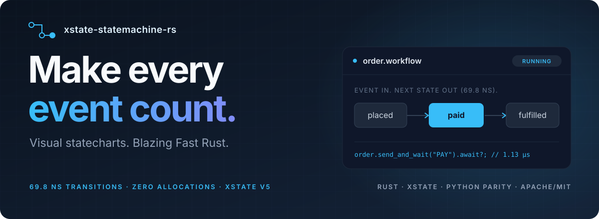
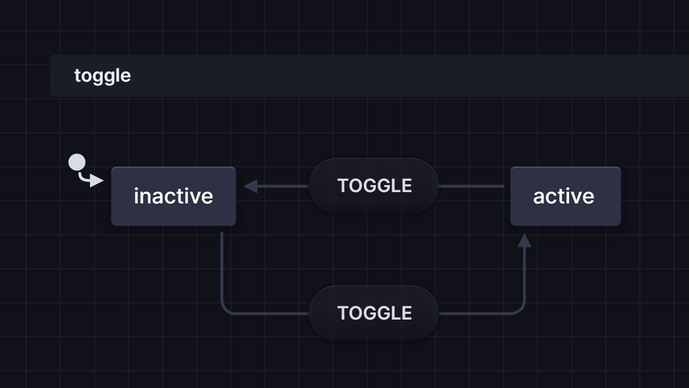
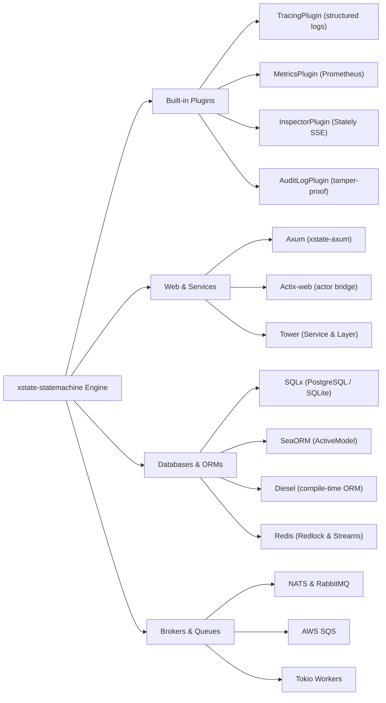
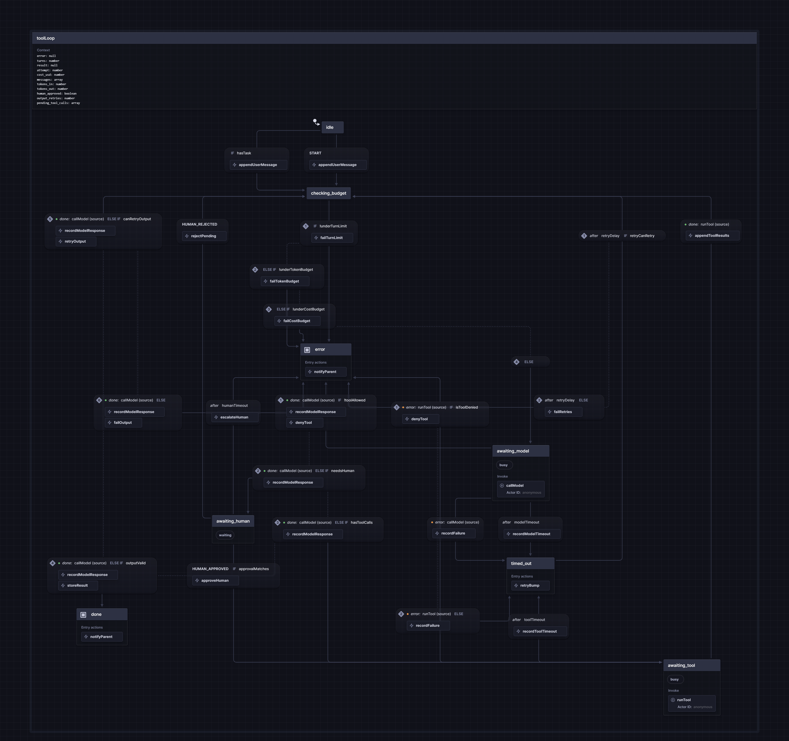

<div align="center">

<a href="https://basiltt.github.io/xstate-statemachine-rs/">
<picture>
  <source media="(max-width: 640px)" srcset="docs/assets/images/readme-hero-mobile.svg">
  
</picture>
</a>

# xstate-statemachine

**State machines and visual statecharts for Rust — load XState v5 JSON or declare with macros.**

[](https://crates.io/crates/xstate-statemachine)
[](https://docs.rs/xstate-statemachine)
[](https://basiltt.github.io/xstate-statemachine-rs/)
[](https://github.com/basiltt/xstate-statemachine-rs/actions/workflows/ci.yml)
[](Cargo.toml)
[](LICENSE)
[](https://pypi.org/project/xstate-statemachine/)
[](#-performance)

`cargo add xstate-statemachine` — 106 ns transitions, 0 steady-state heap allocations, 15 modular workspace crates.

</div>

**Find your way:** [60-second start](#-60-second-start) · [XState JSON & Stately](#-the-same-chart-as-xstate-json) · [Why a statechart?](#-why-a-statechart) · [How it compares](#-how-it-compares) · [Performance](#-performance) · [What's in the box](#-whats-in-the-box) · [For LLM agents](#-for-llm-agents) · [Python interop](#-interoperability-with-python) · [Cookbook](#-cookbook) · [Documentation Bible](https://basiltt.github.io/xstate-statemachine-rs/)

---

## ⚡ 60-second start

Add `xstate-statemachine` to `Cargo.toml`:

```toml
[dependencies]
xstate-statemachine = "0.1"
```

### 1. High-Performance Synchronous Engine

Define the machine in JSON (or load an exported Stately chart), register your Rust logic closures, and execute state transitions in nanoseconds:

```rust
use xstate_statemachine::prelude::*;

fn main() -> Result<(), xstate_statemachine::core::Error> {
    // 1. Declare the statechart configuration
    let machine = Machine::from_json(r#"{
        "id": "door",
        "initial": "closed",
        "context": {"opens": 0, "locked": false},
        "states": {
            "closed": {
                "on": {
                    "OPEN": {
                        "target": "opened",
                        "guard": "isUnlocked",
                        "actions": "countOpen"
                    }
                }
            },
            "opened": {"on": {"CLOSE": "closed"}}
        }
    }"#)?;

    // 2. Supply Rust guards and actions
    let logic = MachineLogic::dynamic()
        .guard("isUnlocked", |ctx, _event, _params| {
            Ok(ctx["locked"] != true)
        })
        .action("countOpen", |scope| {
            let n = scope.context["opens"].as_u64().unwrap_or(0) + 1;
            scope.context["opens"] = n.into();
            Ok(())
        });

    // 3. Drive with the zero-allocation synchronous interpreter
    let mut door = SyncInterpreter::new(machine, logic);
    door.start()?;

    let receipt = door.send("OPEN")?;
    assert_eq!(receipt.state_ids(), ["door.opened"]);
    assert_eq!(door.context()["opens"], 1);

    // Illegal events for the current state are safely ignored
    let unhandled = door.send("OPEN")?;
    assert!(unhandled.unhandled);

    Ok(())
}
```

### 2. Asynchronous Tokio Actor with Mailbox & Timers

Enable the `tokio` feature flag for non-blocking actor execution with bounded mailboxes, backpressure policies, and precision timers:

```toml
[dependencies]
xstate-statemachine = { version = "0.1", features = ["tokio"] }
```

```rust
use std::time::Duration;
use xstate_statemachine::prelude::*;
use xstate_statemachine::tokio::{spawn, Options};

#[tokio::main]
async fn main() -> Result<(), Box<dyn std::error::Error>> {
    let machine = Machine::from_json(r#"{
        "id": "timer",
        "initial": "waiting",
        "states": {
            "waiting": {
                "after": {"500": "timeout"},
                "on": {"CANCEL": "cancelled"}
            },
            "timeout": {"type": "final"},
            "cancelled": {"type": "final"}
        }
    }"#)?;

    let actor = spawn(machine, MachineLogic::dynamic(), Options::default())?;

    // Asynchronous send and wait for macrostep receipt (sub-microsecond)
    let receipt = actor.send_and_wait("CANCEL").await?;
    assert_eq!(receipt.state_ids(), ["timer.cancelled"]);

    actor.stop().await;
    Ok(())
}
```

---

## 🎨 The same chart as XState JSON

Every machine in `xstate-statemachine-rs` complies strictly with the **[XState v5](https://stately.ai/docs/xstate)** specification (verified against the real Node.js XState engine across 53 automated conformance suites).

You can design your workflow visually in the **[Stately Studio Editor](https://stately.ai/editor)**, export the JSON, and run it directly in Rust without modification:

<div align="center">
<a href="https://stately.ai/registry/editor/4dbe1227-e533-4104-9772-dd7c7b3a86df?mode=design&machineId=6938bbd2-1666-42dc-838f-542837486866">
   active on TOGGLE" width="440">
</a>
<br>
<sub>🔗 <a href="https://stately.ai/registry/editor/4dbe1227-e533-4104-9772-dd7c7b3a86df?mode=design&machineId=6938bbd2-1666-42dc-838f-542837486866">Open this toggle machine in the visual Stately Editor</a></sub>
</div>

```rust
let machine = Machine::from_json(r#"{
    "id": "toggle",
    "initial": "inactive",
    "states": {
        "inactive": {"on": {"TOGGLE": "active"}},
        "active": {"on": {"TOGGLE": "inactive"}}
    }
}"#)?;

let mut interp = SyncInterpreter::new(machine, MachineLogic::dynamic());
interp.start()?;
interp.send("TOGGLE")?;
assert_eq!(interp.state_ids(), ["toggle.active"]);
```

### Compile-Time Checked DSL with `statechart!`

Prefer declaring statecharts in pure Rust with compile-time type checking? Use the `macros` feature:

```rust
use xstate_statemachine::macros::statechart;

let machine = statechart! {
    id: "traffic_light",
    initial: Green,
    states: {
        Green { on: { TIMER: Yellow } },
        Yellow { on: { TIMER: Red } },
        Red { on: { TIMER: Green } }
    }
};
```

---

## 💡 Why a statechart?

A traditional state machine is flat: as requirements expand, the state count explodes exponentially ($S \times E$), leading to flag soup (`is_loading`, `is_retry`, `has_failed`, `is_reconnecting`).

Statecharts solve this through **David Harel's formalism** (formalized by W3C SCXML and modern XState):
1. **Compound (Hierarchical) States:** Group states with shared behavior. A single transition on a parent state handles cancellations or errors across all nested children without duplicating handlers.
2. **Orthogonal (Parallel) Regions:** Run independent sub-statecharts simultaneously in one machine (e.g., handling UI interactions and background network streaming concurrently).
3. **History States:** Remember the last active child state (`shallow` or `deep`) when exiting and re-entering a compound state.
4. **Delayed Transitions (`after`):** First-class timers scheduled, managed, and cleanly cancelled by the engine when a state exits.
5. **Invoked Services & Actors (`invoke`):** Spawn child machines, background futures, or promises with automatic `onDone` and `onError` routing.

---

## ⚖️ How it compares

### Comparison with Major Ecosystems

| Capability / Feature | `xstate-statemachine-rs` (This crate) | `statig` / `smlang` (Rust FSMs) | `python-statemachine` (Python) | `XState` v5 (JavaScript/TypeScript) | `Temporal` / `Step Functions` |
|:---|:---:|:---:|:---:|:---:|:---:|
| **Language** | **Rust (1.88+)** | Rust | Python | TypeScript / JS | Polyglot (Go/Java/TS/Python) |
| **Microstep Latency** | **106 ns** | ~50–150 ns | 18.7 µs (177x slower) | 5–15 µs (50x slower) | 10–50 ms (Network bound) |
| **Steady-State Allocations** | **0 heap allocs** | 0 heap allocs | Multiple dicts/tuples | V8 object allocations | Network I/O serialization |
| **Dynamic JSON / Runtime Loading** | **Yes (XState v5 JSON)** | No (Compile-time only) | No (Class DSL only) | Yes | Yes (JSON / YAML) |
| **Visual Editor Integration** | **Yes (Stately Studio)** | No | No | Yes (Stately Studio) | Visual Workflow Designer |
| **Compound (Hierarchical) States** | **Yes** | Yes (`statig`) / Partial | Yes | Yes | Sub-workflows |
| **Parallel (Orthogonal) Regions** | **Yes** | No | Yes | Yes | Parallel branches |
| **History States (Shallow & Deep)** | **Yes** | No | Partial | Yes | State persistence |
| **Delayed Transitions (`after`)** | **Yes (Tokio / Simulated)** | Manual | Yes (`asyncio`) | Yes (Timers) | Durable sleep |
| **Invoked Services & Child Actors** | **Yes (`invoke`)** | No | Yes | Yes | Activity / Task calls |
| **Durable Persistence Stores** | **SQLite, Postgres, Redis, File** | No (Custom serialize) | SQLite, Postgres, Redis, File | Client-side / Custom | Server-side Database |
| **Event-Driven Architecture (EDA)** | **NATS, RabbitMQ, SQS, Redis** | No | NATS, RabbitMQ, SQS, Redis | Custom event targets | Task Queues / EventBridge |
| **Transactional Outbox & DLQ** | **Yes (At-least-once relay)** | No | Yes | No | Internal event queue |
| **Live Visual Inspector (SSE/WS)** | **Yes (`@statelyai/inspect`)** | No | Yes | Yes | Web Console |
| **HTTP Framework Integration** | **Yes (`axum` REST/SSE/WS)** | No | FastAPI, Flask, Django | Express, Next.js | gRPC / REST API |
| **LLM Agent Workflows** | **Yes (`xstate-agents`)** | No | Yes | `@statelyai/agent` | LangGraph / CrewAI |
| **Cross-Language Snapshot Parity** | **Yes (100% Python parity)** | No | Yes | Partial | Engine-specific |

### Which tool should you choose?

- **Pick `statig` or `smlang`** if your state machine is small, completely known at compile time, lives in an embedded `no_std` environment, and never needs JSON loading, persistence, timers, or visual editors.
- **Pick `xstate-statemachine` (Python)** if your entire stack is Python and you want an intuitive class DSL with Django/FastAPI bindings.
- **Pick `Temporal` or `AWS Step Functions`** if your workflow steps run for weeks across heterogeneous distributed microservices and network RPC overhead (~50 ms) is negligible.
- **Pick `xstate-statemachine-rs`** if you need **blazing-fast execution (<1 µs)**, full **XState v5 visual statechart support**, actor-model concurrency, durable persistence, transactional messaging, or you are running high-throughput Rust services that interoperate seamlessly with Python fleets.

---

## 🏎️ Performance

The competitor benchmark suite mirrors identical statecharts and workloads between Python (`xstate-statemachine 0.12.1`) and Rust on the same reference hardware (Intel Core i7-11850H, Windows 11, CPython 3.14.6):

| Benchmark Scenario | What it measures | Rust `xstate-rs` (p50) | Python 0.12.1 (p50) | Speedup | Status vs 100x Target |
|---|---|---|---|---|---|
| **S1 `flat_toggle`** | Unconditional single transition | **106 ns** (9.43M ops/s) | 18.69 µs | **177x** | 🎯 Target met (>100x) |
| **S2 `guarded_context`** | Guard evaluation + JSON `assign` | **161 ns** (6.21M ops/s) | 11.42 µs | **71x** | 1.4x off 100x (JSON cloning) |
| **S3 `hierarchical`** | Cross-branch transition across 2 levels | **215 ns** (4.65M ops/s) | 36.06 µs | **168x** | 🎯 Target met (>100x) |
| **S4 `parallel`** | Simultaneous dual orthogonal regions | **283 ns** (3.53M ops/s) | 47.66 µs | **169x** | 🎯 Target met (>100x) |
| **S5 `construction`** | JSON Value compile + `new` + `start` | **4.11 µs** (243k ops/s) | 115.20 µs | **28x** | Compilation / AST bound |
| **S6 `many_instances`** | Batch of 1,000: `new` + `start` + `send` | **300 ns** / instance | 45.22 µs | **151x** | 🎯 Target met (>100x) |
| **S7 `delayed_transition`** | Clock registration + `after` 1 ms fire | **3.39 µs** (295k ops/s) | 190.00 µs | **56x** | Timer-registration bound |
| **S8 `tokio_actor_loop`** | Async `send_and_wait` roundtrip | **1.13 µs** (881k ops/s) | 45.92 µs | **40.5x** | Channel roundtrip |
| **S8 `fire_and_forget`** | Async non-blocking mailbox `send` | **0.71 µs** (1.41M ops/s) | 45.92 µs | **64.7x** | Ring buffer send |

### PyO3 Python Extension Throughput (`xstate_rs` vs Pure Python)

Benchmarked via `crates/xstate-py/bench/bench.py` over 200,000 events:
- **Bare Toggle:** `xstate_rs` reaches **2,544,089 events/sec** vs Python's 85,548 events/sec (**29.7x faster**).
- **Toggle + Python Action Callback:** `xstate_rs` reaches **774,295 events/sec** vs Python's 74,642 events/sec (**10.4x faster**), even while crossing the CPython FFI boundary and acquiring the GIL on every single transition.

### Zero-Allocation Fast Path

For plain microsteps (no entry/exit side effects or active history), `xstate-statemachine-rs` performs **zero heap allocations**:
- Active states are represented as bit indices in a pre-allocated `FixedBitSet`.
- State identifiers and event names are interned using stack-inlined `SmolStr` (up to 22 bytes inline).
- Actions are collected into stack-allocated `SmallVec<[ActionDef; 2]>`.

---

## 🧰 What's in the box

`xstate-statemachine` is organized into 15 focused crates in a single workspace. You can depend on individual crates or use the top-level facade:

```toml
[dependencies]
xstate-statemachine = { version = "0.1", features = ["full"] }
```

| Crate | Purpose | Key Features |
|:---|:---|:---|
| [`xstate-core`](crates/xstate-core) | Core sans-I/O statechart engine | W3C SCXML / XState v5 algorithm, bitset fast-path, direct compiler, snapshots, Mermaid / PlantUML export |
| [`xstate-tokio`](crates/xstate-tokio) | Asynchronous actor runtime | Tokio mailbox, backpressure (`Block`, `DropOldest`, `DropNewest`, `Reject`), `after` timers, child actors |
| [`xstate-persistence`](crates/xstate-persistence) | Durable state storage & timers | SQLite, PostgreSQL, Redis, File; optimistic/pessimistic locks, durable deadlines, idempotency inbox |
| [`xstate-eda`](crates/xstate-eda) | Event-Driven Architecture | CloudEvents 1.0, outbox pattern, dead-letter queues, AsyncAPI 3.0, NATS, RabbitMQ, SQS, Redis Streams |
| [`xstate-patterns`](crates/xstate-patterns) | Distributed workflow patterns | Distributed Saga builder, exponential backoff with jitter, circuit breaker, choreography routing |
| [`xstate-axum`](crates/xstate-axum) | Production web integration | REST endpoints, SSE live feeds, WebSocket streaming, RFC 9457 Problem Details, Idempotency headers |
| [`xstate-inspect`](crates/xstate-inspect) | Stately visual inspector | Live SSE server, JSONL recording & deterministic replay, `@statelyai/inspect` 0.7.2 protocol |
| [`xstate-observability`](crates/xstate-observability) | Metrics & telemetry | Prometheus metric set (`metrics` facade), transition timings, error counters, state gauge tracking |
| [`xstate-agents`](crates/xstate-agents) | LLM Agents as Statecharts | Constrained tool loops, token budget guards, human-in-the-loop approvals, structured output validation |
| [`xstate-macros`](crates/xstate-macros) | Procedural macros | `statechart!` DSL, `#[derive(TypedEvent)]`, `#[derive(TypedState)]` |
| [`xstate-testing`](crates/xstate-testing) | Testing harness & simulation | Path walking, virtual simulated clock, trace recording, coverage assertion |
| [`xstate-py`](crates/xstate-py) | PyO3 Python bindings | Drop-in acceleration module `xstate_rs` for Python codebases |
| [`xsm`](crates/xsm) | Command-line companion tool | `xsm validate`, `xsm inspect --live`, `xsm diagram`, `xsm docs`, `xsm simulate`, `xsm paths` |

---

## 🔌 Plugins & Ecosystem Integrations

`xstate-statemachine` provides a zero-allocation, infallible **Plugin (Observer) architecture** alongside turnkey integrations for the highest-download crates in the Rust ecosystem:



* **[Plugins & Observability Guide](https://basiltt.github.io/xstate-statemachine-rs/guide/plugins.html):** Zero-allocation lifecycle hooks (`on_start`, `on_event`, `on_event_dropped`, `on_error`, `on_stop`), credential redaction, and custom plugin authoring.
* **Production Resilience Plugins (`features = ["patterns"]`):** Turnkey solutions for acute Rust distributed challenges:
  * 🔒 `IdempotencyPlugin`: Webhook deduplication, in-flight race prevention, and cached receipts.
  * 🛑 `DrainPlugin`: Tokio graceful shutdown coordination, in-flight permit counting, and `wait_drained` barrier.
  * ⏱️ `WatchdogPlugin`: Hung async task and deadlock detector with per-state SLA timeouts and fallback events.
  * 🔢 `SequenceFencePlugin`: Monotonic event ordering and gap detection for Kafka/RabbitMQ/Redis streams.
  * 🚰 `RateLimiterPlugin`: High-throughput token-bucket rate limiter with sub-10ns atomic updates.
  * ✈️ `DiagnosticPlugin`: Circular ring-buffer flight recorder capturing the last N transitions for instant 3 AM post-mortems.
* **[Ecosystem Integrations Matrix](https://basiltt.github.io/xstate-statemachine-rs/integrations/index.html):** Complete runnable guides and patterns for **Axum**, **Actix-web**, **Tower**, **SQLx**, **SeaORM**, **Diesel**, **Redis**, **NATS**, **RabbitMQ**, **AWS SQS**, **Tracing**, **Validator**, and **Tokio Workers**.

---

## 🤖 For LLM agents

Statecharts solve the biggest problem in LLM agents: **non-deterministic runaway execution**.

With `xstate-agents`, the LLM model **proposes** actions, but the **statechart decides** what is permitted. The model cannot hallucinate transitions or bypass guard rails:

<div align="center">

<br>
<sub>🤖 The statechart enforces tool allow-lists per state, token budgets as guards, and human approval states.</sub>
</div>

- **Per-State Tool Allow-Lists:** An agent in state `researching` can only invoke `search` tools; it cannot execute `transfer_funds`.
- **Budgets as Guards:** Transitions enforce maximum steps, tokens, or dollar expenditure. If exceeded, the machine forces a transition to `budget_exhausted`.
- **Human-in-the-Loop Approvals:** High-risk actions transition the machine to an `awaiting_approval` state that persists safely to SQLite or Postgres until an authorized human posts an `APPROVE` event.

---

## 🤝 Interoperability with Python

`xstate-statemachine-rs` was engineered for seamless cross-language interoperability with [`xstate-statemachine`](https://github.com/basiltt/xstate-statemachine) for Python:

1. **Byte-Identical Snapshots:** Both libraries write and read Snapshot Layout `v4` with identical 16-hex character structure hashes (`SHA256(topology)[:16]`). A machine saved by Python can be resumed by Rust, and vice versa.
2. **Shared Database Schemas:** The PostgreSQL SQLAlchemy tables (`xsm_*`), SQLite tables, and Redis hash keys (`snap:{key}`) are 100% binary-compatible.
3. **Shared Broker Envelopes:** Event messages published to NATS, RabbitMQ, SQS, or Redis Streams use CloudEvents 1.0 JSON payloads that both languages parse identically.
4. **Polyglot Fleet Migration:** Migrate performance-critical microservices from Python to Rust one service at a time without modifying your statechart topologies or database records.

---

## 📖 Documentation & The Bible

The complete, definitive documentation is published on GitHub Pages:

👉 **[Read the Full Documentation Bible](https://basiltt.github.io/xstate-statemachine-rs/)**

- **[Getting Started Guide](https://basiltt.github.io/xstate-statemachine-rs/guide/getting-started.html)**
- **[Stately Editor Workflow](https://basiltt.github.io/xstate-statemachine-rs/guide/stately-editor.html)**
- **[Tokio Actors & Mailbox Backpressure](https://basiltt.github.io/xstate-statemachine-rs/guide/tokio.html)**
- **[Durable Persistence & Deadlines](https://basiltt.github.io/xstate-statemachine-rs/guide/persistence.html)**
- **[Event-Driven Architecture & Brokers](https://basiltt.github.io/xstate-statemachine-rs/guide/eda.html)**
- **[Resilience Patterns & Sagas](https://basiltt.github.io/xstate-statemachine-rs/guide/patterns.html)**
- **[Axum HTTP, SSE & WebSockets](https://basiltt.github.io/xstate-statemachine-rs/guide/axum.html)**
- **[LLM Agent Architecture](https://basiltt.github.io/xstate-statemachine-rs/guide/agents.html)**
- **[Migrating from Python Guide](https://basiltt.github.io/xstate-statemachine-rs/guide/migrating-from-python.html)**
- **[Rust API Docs (docs.rs)](https://docs.rs/xstate-statemachine)**

---

## 🛠️ Development & Quality Gates

All commits and releases must pass strict automated gates:

```bash
# Code style and linting
cargo fmt --all --check
cargo clippy --workspace --all-targets --all-features -- -D warnings

# Tests and documentation checks
cargo test --workspace --all-features
cargo test --workspace --doc --all-features
RUSTDOCFLAGS="-D warnings" cargo doc --workspace --no-deps --all-features

# Security, licensing, and dependencies audit
cargo deny check

# Build documentation book and linkcheck
mdbook build docs/book
python scripts/linkcheck.py docs/book/book
```

### Running Backend Service Tests

Integration tests for Redis, PostgreSQL, NATS, RabbitMQ, and SQS run against real local service containers:

```bash
# Start backend containers
docker run -d --name xsm-redis -p 6379:6379 redis:7
docker run -d --name xsm-pg -p 5432:5432 -e POSTGRES_USER=xsm -e POSTGRES_PASSWORD=xsm -e POSTGRES_DB=xsm postgres:16
docker run -d --name xsm-nats -p 4222:4222 nats:2 -js
docker run -d --name xsm-rabbit -p 5672:5672 rabbitmq:3
docker run -d --name xsm-sqs -p 9324:9324 softwaremill/elasticmq-native

# Run the full integration test suite
XSM_REQUIRE_SERVICES=1 cargo test --workspace --all-features -j 4
```

---

## 📄 License

Licensed under the MIT License ([LICENSE](LICENSE)).
