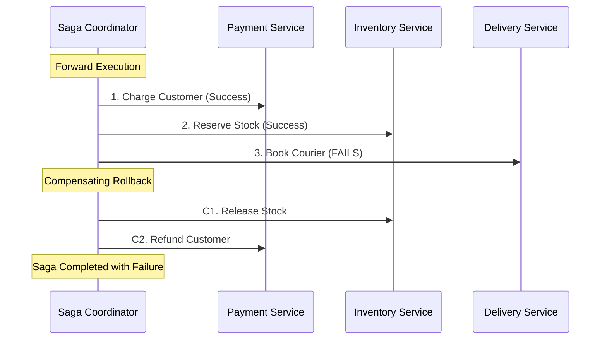

# Recipe: Distributed E-Commerce Saga

In microservice architectures, two-phase commits across distributed databases are slow and fragile. The **Saga pattern** breaks a multi-service business transaction into discrete local transactions. If any step fails, the saga executes compensating transactions in reverse order to restore consistency.

---

## Saga Flow Diagram



---

## Rust Implementation

Using `xstate_patterns::saga::SagaBuilder`:

```rust
use serde_json::json;
use xstate_patterns::saga::SagaBuilder;
use xstate_statemachine::prelude::*;

#[tokio::main]
async fn main() -> Result<(), Box<dyn std::error::Error>> {
    // Build a 3-step saga: Payment -> Inventory -> Delivery
    let saga = SagaBuilder::new("order_saga")
        .step("charge_payment", "refund_payment")
        .step("reserve_inventory", "release_inventory")
        .step("book_delivery", "cancel_delivery")
        .build()?;

    let logic = MachineLogic::dynamic()
        .action("charge_payment", |scope| {
            println!("Forward action: Charging credit card $120.00...");
            scope.context["payment_id"] = json!("ch_849281");
            Ok(())
        })
        .action("refund_payment", |_scope| {
            println!("Compensating action: Refunding credit card $120.00...");
            Ok(())
        })
        .action("reserve_inventory", |scope| {
            println!("Forward action: Reserving item in warehouse A...");
            scope.context["inventory_reserved"] = json!(true);
            Ok(())
        })
        .action("release_inventory", |_scope| {
            println!("Compensating action: Releasing warehouse reservation...");
            Ok(())
        })
        .action("book_delivery", |_scope| {
            println!("Forward action: Booking courier...");
            // Simulate delivery partner outage
            Err(Error::logic("Delivery courier API unavailable"))
        })
        .action("cancel_delivery", |_scope| {
            Ok(())
        });

    let mut interpreter = SyncInterpreter::new(saga, logic);
    interpreter.start()?;

    // Step 1: Charge Payment
    interpreter.send("charge_payment.SUCCESS")?;
    
    // Step 2: Reserve Inventory
    interpreter.send("reserve_inventory.SUCCESS")?;

    // Step 3: Courier fails! Trigger automatic compensation
    interpreter.send("book_delivery.FAILURE")?;

    // The saga automatically executes compensating rollbacks in reverse:
    // 1. release_inventory
    // 2. refund_payment
    // And lands in the terminal compensation complete state:
    assert!(interpreter.matches("order_saga.compensated") || interpreter.matches("order_saga.failed"));
    println!("Saga cleanly compensated all distributed resources.");

    Ok(())
}
```

---

## Key Advantages
- **Declarative Graph:** The entire compensation DAG is validated at compile time by `SagaBuilder`.
- **Durable Audit Trail:** Every step and compensation action is emitted as a structured CloudEvent or persisted to PostgreSQL using `xstate-persistence`.
- **Zero Orphaned State:** If a worker crashes mid-saga, the persisted statechart recovers and continues rolling back precisely where it left off.
