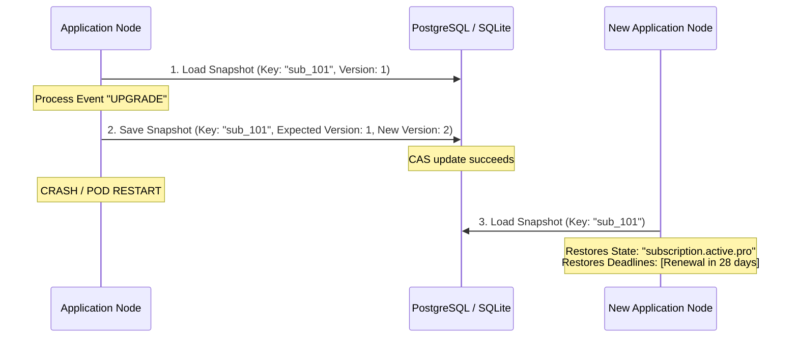

# Recipe: Durable Persistence & Crash Recovery

Critical business processes (subscription billing, human approvals, loan underwriting) span hours or days and must survive process restarts, deployments, and hardware crashes.

This recipe demonstrates using `xstate-persistence` with SQLite or PostgreSQL to persist state, detect concurrent modification via optimistic locking, and resume durable timers.

---

## Architecture Flow



---

## Rust Implementation

```rust
use std::sync::Arc;
use xstate_persistence::sqlite::SqliteStore;
use xstate_persistence::{PersistedOptions, Store};
use xstate_statemachine::prelude::*;

#[tokio::main]
async fn main() -> Result<(), Box<dyn std::error::Error>> {
    // 1. Initialize persistent storage (SQLite or PostgreSQL)
    let store = Arc::new(SqliteStore::open_in_memory()?);
    store.migrate().await?;

    // 2. Define the subscription statechart
    let machine = Machine::from_json(r#"{
        "id": "subscription",
        "initial": "trialing",
        "context": {"plan": "trial", "customer_id": "cust_821"},
        "states": {
            "trialing": {
                "after": {"86400000": "expired"},
                "on": {"UPGRADE": "active"}
            },
            "active": {
                "initial": "pro",
                "states": {
                    "pro": {"on": {"DOWNGRADE": "basic"}},
                    "basic": {"on": {"UPGRADE": "pro"}}
                },
                "on": {"CANCEL": "cancelled"}
            },
            "expired": {"type": "final"},
            "cancelled": {"type": "final"}
        }
    }"#)?;

    let instance_key = "sub_cust_821";

    // 3. Start interpreter, process transition, and persist
    {
        let mut interp = SyncInterpreter::new(machine.clone(), MachineLogic::dynamic());
        interp.start()?;
        interp.send("UPGRADE")?;
        assert_eq!(interp.state_ids(), ["subscription.active.pro"]);

        // Save snapshot to database
        let snapshot = interp.snapshot();
        store.put(instance_key, &snapshot, None).await?;
        println!("Successfully persisted snapshot to database.");
    }

    // 4. Simulate process restart / new worker loading the saved state
    {
        let loaded_record = store.get(instance_key).await?.expect("snapshot found");
        let restored_interp = SyncInterpreter::from_snapshot(
            machine,
            MachineLogic::dynamic(),
            &loaded_record.snapshot,
            Arc::new(SimulatedClock::new()),
            &Default::default(),
        )?;

        assert_eq!(restored_interp.state_ids(), ["subscription.active.pro"]);
        assert_eq!(restored_interp.context()["customer_id"], "cust_821");
        println!("Restored interpreter perfectly matches persisted state.");
    }

    Ok(())
}
```

---

## Operational Guarantees
- **Optimistic Locking:** If another worker thread tries to write to `sub_cust_821` with a stale version, `store.put()` returns `StoreError::Conflict`, preventing split-brain state overwrite.
- **Binary Parity with Python:** A snapshot saved by this Rust code can be loaded directly by a Python service running `xstate-statemachine` 0.12.1 using the same PostgreSQL or SQLite table (`xsm_statecharts`).
- **Durable Timers:** State deadlines are indexed in the `deadlines` table. A background scanner picks up and fires overdue events even if the application was offline when the deadline expired.
