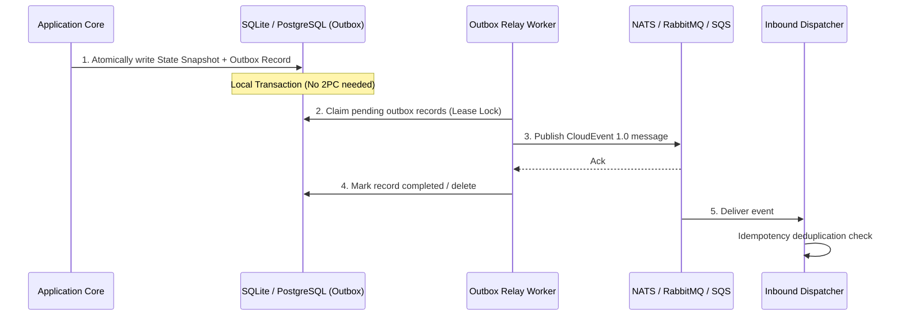

# Recipe: Event-Driven Architecture & Transactional Outbox

When state machine transitions must emit events to external message brokers (NATS, RabbitMQ, Apache Kafka, AWS SQS), doing network I/O directly inside transition actions violates transactional boundaries (dual-write hazard).

This recipe demonstrates using `xstate-eda` to implement the **Transactional Outbox Pattern**: state transitions write an outgoing event atomically to the database, and an outbox relay reliably delivers it with at-least-once guarantees.

---

## Architecture Flow



---

## Rust Implementation

```rust
use std::sync::Arc;
use xstate_eda::envelope::Envelope;
use xstate_eda::outbox::{MemoryOutbox, OutboxStore};
use xstate_statemachine::prelude::*;

#[tokio::main]
async fn main() -> Result<(), Box<dyn std::error::Error>> {
    // 1. Initialize outbox store
    let outbox = Arc::new(MemoryOutbox::new());

    // 2. Define the payment statechart
    let machine = Machine::from_json(r#"{
        "id": "payment",
        "initial": "authorizing",
        "states": {
            "authorizing": {
                "on": {"APPROVED": "completed"}
            },
            "completed": {"type": "final"}
        }
    }"#)?;

    // 3. Process transition
    let mut interp = SyncInterpreter::new(machine, MachineLogic::dynamic());
    interp.start()?;
    interp.send("APPROVED")?;

    // 4. Construct a compliant CloudEvents 1.0 envelope
    let event = Envelope::new(
        "payment.completed",
        "orders/8492",
        serde_json::json!({
            "order_id": "8492",
            "amount_cents": 4900,
            "currency": "USD"
        }),
    );

    // 5. Stage to outbox atomically
    outbox.stage(&event).await?;
    println!("Event staged to transactional outbox with ID: {}", event.id);

    // 6. Outbox relay claims and publishes batch
    let pending_batch = outbox.claim_batch(10, std::time::Duration::from_secs(30)).await?;
    assert_eq!(pending_batch.len(), 1);

    for record in &pending_batch {
        println!("Relay dispatching to broker: topic={}, event_id={}", record.envelope.subject, record.envelope.id);
        // ... publish to NATS or RabbitMQ ...
    }

    // Acknowledge completed delivery
    let ids: Vec<_> = pending_batch.iter().map(|r| r.envelope.id.as_str()).collect();
    outbox.mark_published(&ids).await?;
    println!("Outbox delivery acknowledged.");

    Ok(())
}
```

---

## Resilience Features
- **Zero Dual-Write Race Conditions:** Events are committed in the same database transaction as the state transition.
- **Dead-Letter Queue (DLQ):** Poison messages that exceed retry limits are diverted to the `DeadLetterSink` with failure diagnostics.
- **AsyncAPI 3.0 Generation:** `xsm asyncapi` generates standard AsyncAPI specification documents from your statecharts automatically.
