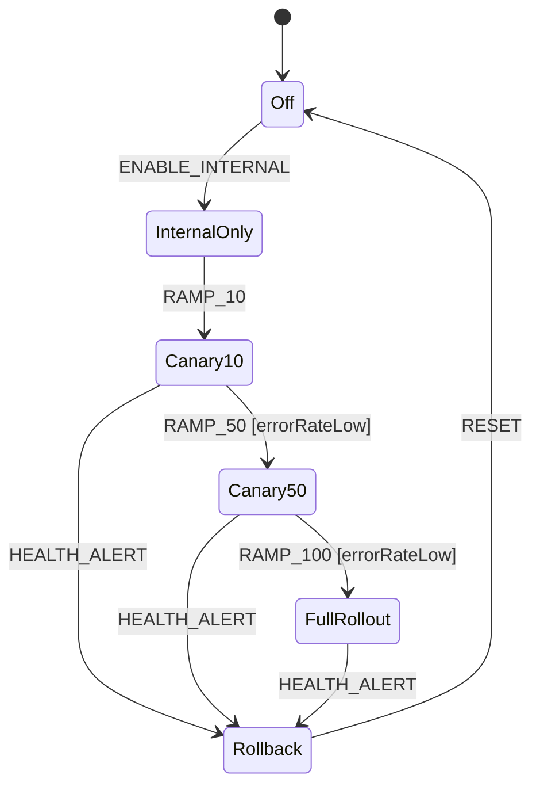

# Recipe: Feature Flag Progressive Rollout

Canary release statechart: ramp up percentage traffic safely with health checks and instant automated rollback.

---

## 🎯 Statechart Topology



---

## 🛠️ Complete Rust Implementation

```rust
use xstate_statemachine::prelude::*;

const ROLLOUT_MACHINE: &str = r#"{
    "id": "canary_rollout",
    "initial": "off",
    "context": {
        "percentage": 0,
        "error_rate": 0.001
    },
    "states": {
        "off": {
            "on": {"ENABLE_INTERNAL": "internal_only"}
        },
        "internal_only": {
            "on": {
                "RAMP_10": {
                    "target": "canary_10",
                    "actions": "set10"
                }
            }
        },
        "canary_10": {
            "on": {
                "RAMP_50": {
                    "target": "canary_50",
                    "guard": "isHealthGood",
                    "actions": "set50"
                },
                "ALERT": "rollback"
            }
        },
        "canary_50": {
            "on": {
                "RAMP_100": {
                    "target": "full_rollout",
                    "guard": "isHealthGood",
                    "actions": "set100"
                },
                "ALERT": "rollback"
            }
        },
        "full_rollout": {
            "on": {"ALERT": "rollback"}
        },
        "rollback": {
            "entry": "emergencyShedLoad",
            "on": {"RESET": "off"}
        }
    }
}"#;

fn main() -> Result<(), Box<dyn std::error::Error>> {
    let machine = Machine::from_json(ROLLOUT_MACHINE)?;

    let logic = MachineLogic::dynamic()
        .guard("isHealthGood", |ctx, _event, _params| {
            let error_rate = ctx["error_rate"].as_f64().unwrap_or(0.0);
            Ok(error_rate < 0.01) // Error rate under 1%
        })
        .action("set10", |scope| {
            scope.context["percentage"] = 10.into();
            Ok(())
        })
        .action("set50", |scope| {
            scope.context["percentage"] = 50.into();
            Ok(())
        })
        .action("set100", |scope| {
            scope.context["percentage"] = 100.into();
            Ok(())
        })
        .action("emergencyShedLoad", |scope| {
            scope.context["percentage"] = 0.into();
            eprintln!("🚨 ALERT TRIGGERED: Feature rolled back to 0% traffic!");
            Ok(())
        });

    let mut interp = SyncInterpreter::new(machine, logic);
    interp.start()?;

    interp.send("ENABLE_INTERNAL")?;
    interp.send("RAMP_10")?;
    assert_eq!(interp.context()["percentage"], 10);

    // Sudden error spike triggers instant automated rollback!
    interp.send("ALERT")?;
    assert_eq!(interp.state_ids(), ["canary_rollout.rollback"]);
    assert_eq!(interp.context()["percentage"], 0);

    Ok(())
}
```
