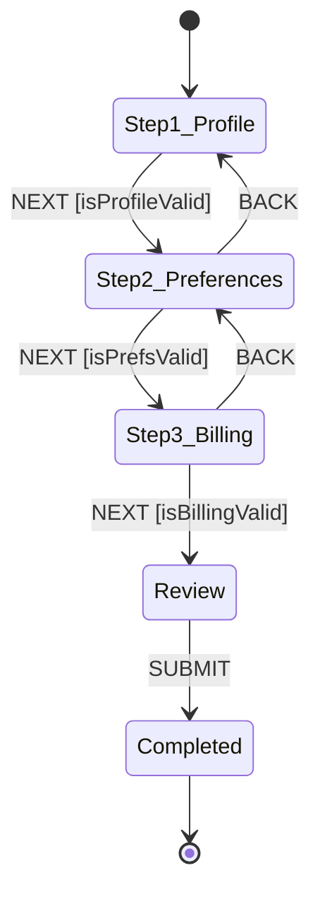

# Recipe: Form Wizard & Multi-Step Onboarding

Manage multi-step forms, user onboarding, back/next navigation, step validation, and draft persistence with `xstate-statemachine`.

---

## 🎯 Statechart Topology



---

## 🛠️ Complete Implementation

```rust
use xstate_statemachine::prelude::*;

const WIZARD_MACHINE: &str = r#"{
    "id": "signup_wizard",
    "initial": "step1_profile",
    "context": {
        "full_name": "",
        "email": "",
        "newsletter": false,
        "plan": "starter"
    },
    "states": {
        "step1_profile": {
            "on": {
                "NEXT": {
                    "target": "step2_preferences",
                    "guard": "isProfileComplete"
                }
            }
        },
        "step2_preferences": {
            "on": {
                "BACK": "step1_profile",
                "NEXT": "step3_review"
            }
        },
        "step3_review": {
            "on": {
                "BACK": "step2_preferences",
                "SUBMIT": "completed"
            }
        },
        "completed": {
            "type": "final"
        }
    }
}"#;

fn main() -> Result<(), Box<dyn std::error::Error>> {
    let machine = Machine::from_json(WIZARD_MACHINE)?;

    let logic = MachineLogic::dynamic()
        .guard("isProfileComplete", |ctx, _event, _params| {
            let name = ctx["full_name"].as_str().unwrap_or("");
            let email = ctx["email"].as_str().unwrap_or("");
            Ok(!name.is_empty() && email.contains('@'))
        });

    let mut interp = SyncInterpreter::new(machine, logic);
    interp.start()?;

    // Attempting NEXT with empty profile is rejected by guard
    let receipt = interp.send("NEXT")?;
    assert!(receipt.unhandled || receipt.state_ids() == ["signup_wizard.step1_profile"]);

    // Populate context and proceed
    interp.context_mut()["full_name"] = "Alice Smith".into();
    interp.context_mut()["email"] = "alice@example.com".into();

    let receipt = interp.send("NEXT")?;
    assert_eq!(receipt.state_ids(), ["signup_wizard.step2_preferences"]);

    Ok(())
}
```
