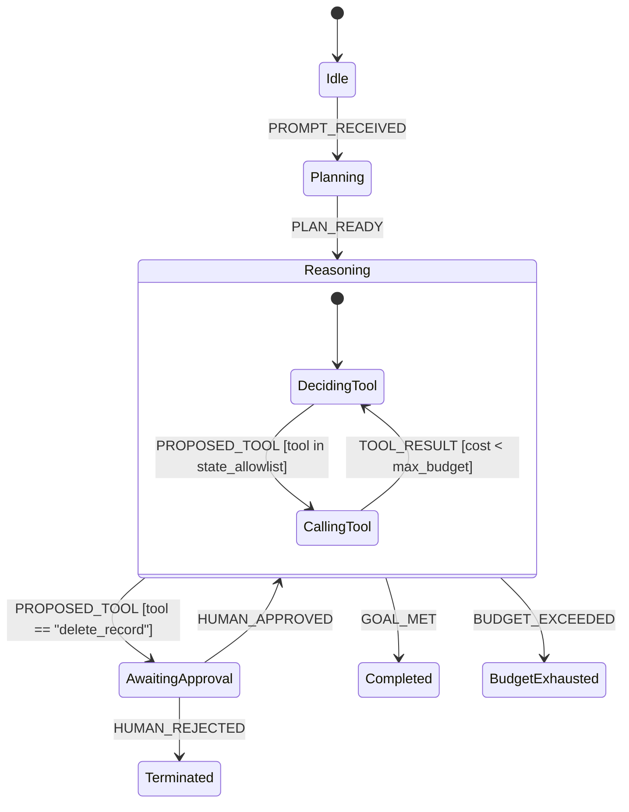

# Recipe: LLM Agent Tool Loop with Guardrail Budgets

Autonomous AI agents often suffer from non-deterministic execution: hallucinating non-existent tools, entering endless execution loops, or attempting dangerous unauthorized actions.

Using `xstate-agents`, the control flow is governed by a formal statechart: **the LLM model proposes actions, but the statechart decides what is allowed.**

---

## Agent Statechart Topology



---

## Rust Implementation

```rust
use serde_json::json;
use xstate_agents::budget::BudgetGuard;
use xstate_agents::registry::ToolRegistry;
use xstate_statemachine::prelude::*;

#[tokio::main]
async fn main() -> Result<(), Box<dyn std::error::Error>> {
    // 1. Register available tools
    let mut tools = ToolRegistry::new();
    tools.register("search_docs", |_input| {
        Ok(json!({"matches": ["Pricing is $49/mo"]}))
    });
    tools.register("delete_database", |_input| {
        Ok(json!({"status": "deleted"}))
    });

    // 2. Define agent statechart with budget guards & tool allow-lists
    let machine = Machine::from_json(r#"{
        "id": "agent_loop",
        "initial": "reasoning",
        "context": {
            "tokens_spent": 120,
            "max_tokens": 1000,
            "approved": false
        },
        "states": {
            "reasoning": {
                "on": {
                    "CALL_TOOL": [
                        {
                            "target": "awaiting_approval",
                            "guard": "requiresApproval"
                        },
                        {
                            "target": "reasoning",
                            "guard": "underBudget",
                            "actions": "recordToolCall"
                        }
                    ],
                    "FINISH": "completed"
                }
            },
            "awaiting_approval": {
                "on": {
                    "APPROVE": {
                        "target": "reasoning",
                        "actions": "markApproved"
                    },
                    "REJECT": "rejected"
                }
            },
            "completed": {"type": "final"},
            "rejected": {"type": "final"}
        }
    }"#)?;

    let logic = MachineLogic::dynamic()
        .guard("underBudget", |ctx, _e, _p| {
            let spent = ctx["tokens_spent"].as_u64().unwrap_or(0);
            let limit = ctx["max_tokens"].as_u64().unwrap_or(1000);
            Ok(spent < limit)
        })
        .guard("requiresApproval", |_ctx, event, _p| {
            Ok(event.data().get("tool").and_then(|t| t.as_str()) == Some("delete_database"))
        })
        .action("recordToolCall", |scope| {
            let spent = scope.context["tokens_spent"].as_u64().unwrap_or(0) + 150;
            scope.context["tokens_spent"] = json!(spent);
            Ok(())
        })
        .action("markApproved", |scope| {
            scope.context["approved"] = json!(true);
            Ok(())
        });

    let mut agent = SyncInterpreter::new(machine, logic);
    agent.start()?;

    // Routine safe tool call succeeds within budget
    agent.send(Event::with_data("CALL_TOOL", json!({"tool": "search_docs"})))?;
    assert_eq!(agent.state_ids(), ["agent_loop.reasoning"]);
    assert_eq!(agent.context()["tokens_spent"], 270);

    // High-risk tool call triggers mandatory human approval transition
    agent.send(Event::with_data("CALL_TOOL", json!({"tool": "delete_database"})))?;
    assert_eq!(agent.state_ids(), ["agent_loop.awaiting_approval"]);

    // Operator approves the pending action
    agent.send("APPROVE")?;
    assert_eq!(agent.state_ids(), ["agent_loop.reasoning"]);
    assert_eq!(agent.context()["approved"], true);

    Ok(())
}
```

---

## Safety Guarantees
- **Impossible to Hallucinate Unapproved Tools:** Tool allow-lists are enforced by guards in the statechart engine. The model cannot bypass the state constraint.
- **Hard Cost Caps:** Tokens, API calls, and dollar amounts are tracked in the chart context. If `underBudget` returns false, transitions are rejected or rerouted to a graceful fallback state.
- **Offline Deterministic Testing:** Agent loops can be fuzzed, unit tested, and replayed deterministically in CI without calling real LLM APIs.
