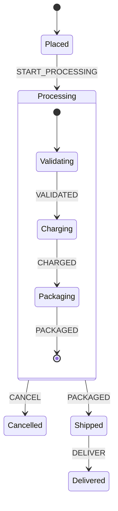

# Recipe: Hierarchical Order Fulfillment

E-commerce order fulfillment is a classic hierarchical state machine. A root compound state `processing` contains child substates (`validating`, `charging`, `packaging`). Any cancellation event (`CANCEL`) received while in any of the child states immediately unwinds and transitions to `cancelled`, eliminating repetitive cancellation logic across multiple states.

---

## Statechart Topology



---

## Rust Implementation

```rust
use serde_json::json;
use xstate_statemachine::prelude::*;

fn create_order_machine() -> Result<SyncInterpreter, xstate_statemachine::core::Error> {
    let machine = Machine::from_json(r#"{
        "id": "order",
        "initial": "placed",
        "context": {
            "order_id": "ORD-9481",
            "items_count": 3,
            "total_cents": 4900,
            "refunded": false
        },
        "states": {
            "placed": {
                "on": {"START_PROCESSING": "processing"}
            },
            "processing": {
                "initial": "validating",
                "on": {
                    "CANCEL": {
                        "target": "cancelled",
                        "actions": "handleRefund"
                    }
                },
                "states": {
                    "validating": {
                        "on": {"VALIDATED": "charging"}
                    },
                    "charging": {
                        "on": {"CHARGED": "packaging"}
                    },
                    "packaging": {
                        "on": {"PACKAGED": "#order.shipped"}
                    }
                }
            },
            "shipped": {
                "on": {"DELIVER": "delivered"}
            },
            "delivered": {
                "type": "final"
            },
            "cancelled": {
                "type": "final"
            }
        }
    }"#)?;

    let logic = MachineLogic::dynamic()
        .action("handleRefund", |scope| {
            println!("Order cancelled during processing: initiating refund...");
            scope.context["refunded"] = json!(true);
            Ok(())
        });

    let mut interpreter = SyncInterpreter::new(machine, logic);
    interpreter.start()?;
    Ok(interpreter)
}

fn main() -> Result<(), Box<dyn std::error::Error>> {
    let mut order = create_order_machine()?;
    assert_eq!(order.state_ids(), ["order.placed"]);

    // Move into the compound processing state; enters initial child substate 'validating'
    order.send("START_PROCESSING")?;
    assert_eq!(order.state_ids(), ["order.processing.validating"]);

    // Advance to charging
    order.send("VALIDATED")?;
    assert_eq!(order.state_ids(), ["order.processing.charging"]);

    // A cancellation event sent here transitions from processing.charging -> cancelled directly
    order.send("CANCEL")?;
    assert_eq!(order.state_ids(), ["order.cancelled"]);
    assert_eq!(order.context()["refunded"], true);

    Ok(())
}
```

---

## Architectural Advantages
- **No Duplicate Handlers:** In flat state machines, `CANCEL` transitions must be defined separately on `validating`, `charging`, and `packaging`. In a statechart, the parent `processing` state handles it uniformly.
- **Atomic Exit Actions:** Any exit actions defined on `charging` or `processing` execute in strict hierarchical order during cancellation.
- **Deep Identification:** States are indexed by canonical IDs (e.g., `order.processing.validating`), allowing precise snapshotting and telemetry queries.
