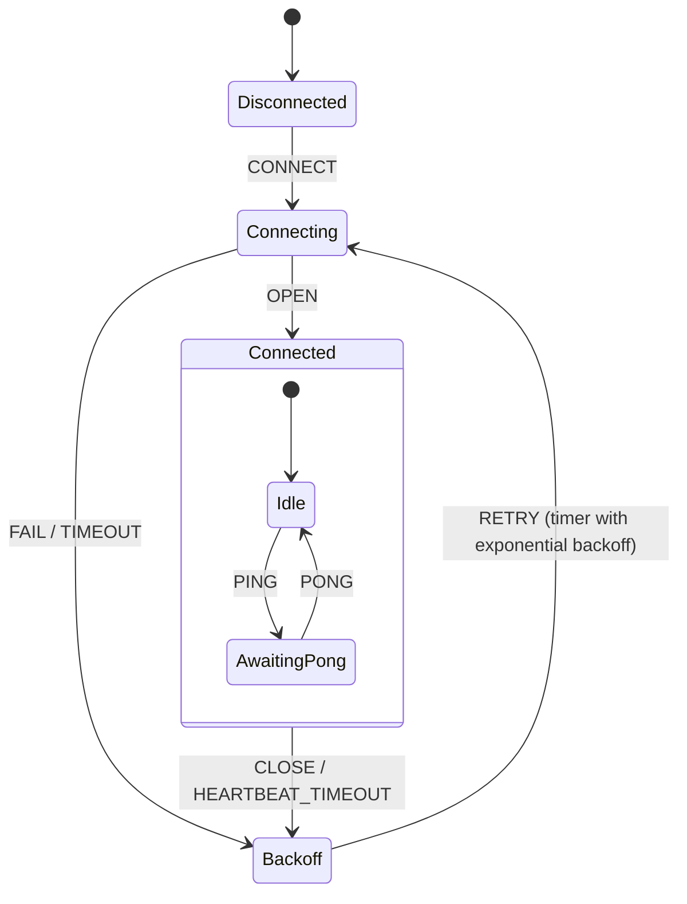

# Recipe: WebSocket Reconnection & Heartbeat

A resilient WebSocket connection manager statechart with exponential backoff, jitter, ping/pong health monitoring, and offline message queueing.

---

## 🎯 Statechart Topology



---

## 🛠️ Complete Rust Implementation

```rust
use std::sync::Arc;
use std::time::Duration;
use tokio::time::sleep;
use xstate_statemachine::prelude::*;
use xstate_statemachine::tokio::{spawn, Options, Interpreter};

const WS_MACHINE_JSON: &str = r#"{
    "id": "websocket_client",
    "initial": "disconnected",
    "context": {
        "retry_count": 0,
        "max_retries": 10,
        "queued_messages": []
    },
    "states": {
        "disconnected": {
            "on": {"CONNECT": "connecting"}
        },
        "connecting": {
            "on": {
                "OPEN": {
                    "target": "connected",
                    "actions": "resetRetries"
                },
                "FAIL": {
                    "target": "backoff",
                    "actions": "incrementRetries"
                }
            }
        },
        "connected": {
            "initial": "idle",
            "states": {
                "idle": {
                    "on": {"SEND_PING": "awaiting_pong"}
                },
                "awaiting_pong": {
                    "after": {"5000": "#websocket_client.backoff"},
                    "on": {"PONG": "idle"}
                }
            },
            "on": {
                "DISCONNECT": "disconnected",
                "NETWORK_LOST": {
                    "target": "backoff",
                    "actions": "incrementRetries"
                }
            }
        },
        "backoff": {
            "after": {"2000": "connecting"}
        }
    }
}"#;

#[tokio::main]
async fn main() -> Result<(), Box<dyn std::error::Error>> {
    let machine = Machine::from_json(WS_MACHINE_JSON)?;

    let logic = MachineLogic::dynamic()
        .action("resetRetries", |scope| {
            scope.context["retry_count"] = 0.into();
            println!("✅ Connected! Flushed retries.");
            Ok(())
        })
        .action("incrementRetries", |scope| {
            let count = scope.context["retry_count"].as_u64().unwrap_or(0) + 1;
            scope.context["retry_count"] = count.into();
            println!("⚠️ Connection failed. Retrying (attempt {count})...");
            Ok(())
        });

    let client = spawn(machine, logic, Options::default())?;

    // 1. Initial connect
    client.send("CONNECT").await?;
    println!("State: {:?}", client.view().state_ids);

    // 2. Simulate connection success
    client.send("OPEN").await?;
    println!("State: {:?}", client.view().state_ids);

    // 3. Heartbeat ping-pong
    client.send("SEND_PING").await?;
    println!("State: {:?}", client.view().state_ids);

    client.send("PONG").await?;
    println!("State: {:?}", client.view().state_ids);

    client.stop().await;
    Ok(())
}
```
