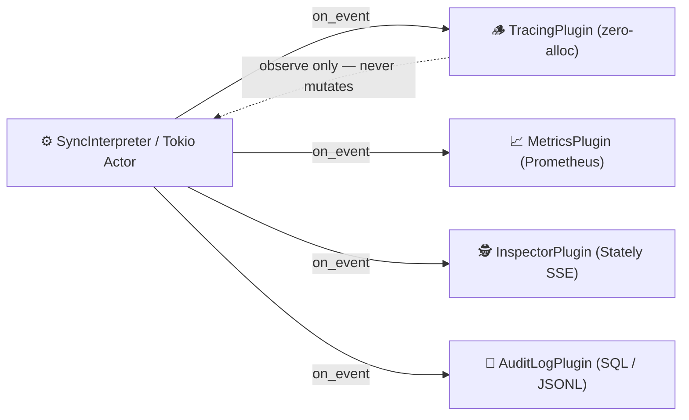

# Plugins & Observability

Observe every event, microstep, transition, action, guard, and service in your statecharts with zero-allocation, infallible lifecycle hooks.

---

## 🔌 What are Plugins?



In `xstate-statemachine`, a **Plugin** implements the **Observer pattern**: it subscribes to lifecycle events across the interpreter and reacts to them (e.g. logging structured spans, incrementing Prometheus counters, streaming to Stately Studio, or writing tamper-proof audit trails).

### Key Architectural Guarantees

1. **Non-Invasive:** Plugins observe statechart execution; they cannot alter machine transitions, mutate state topology, or interfere with fast-path decision logic.
2. **Zero Overhead Fast Path:** Attaching zero plugins incurs 0 runtime cost (`is_empty` check). When attached, hooks receive borrowed references (`&Machine`, `&Event`, `&ActiveState<C>`) without performing heap allocations.
3. **Panic Containment:** In Tokio actors, plugin panics are caught and contained; a faulty plugin cannot bring down your statechart actor.
4. **Thread-Safe by Design:** Plugins implement `Send + Sync`. Observers maintain state via interior mutability (`AtomicU64`, `Mutex`, `RwLock`).

---

## 🪝 Complete Hook Reference

Every plugin implements the [`Observer<C>`](https://docs.rs/xstate-core/latest/xstate_core/observer/trait.Observer.html) trait. All methods provide default no-op implementations:

| Hook | Signature | When It Fires |
|:---|:---|:---|
| `on_start` | `(&self, machine, state, report)` | When the interpreter initializes and enters its initial configuration |
| `on_event` | `(&self, machine, event, report, state)` | Immediately after an event is processed to completion (macrostep settled) |
| `on_event_dropped` | `(&self, machine, event, reason)` | When an event cannot be processed (`"stopped"`, `"deferred"`, `"deferred_overflow"`, `"unresolved_target"`) |
| `on_error` | `(&self, machine, error)` | When a transition or effect fails with an execution error |
| `on_stop` | `(&self, machine, state)` | When the interpreter or actor is stopped by the host application |

```rust
use std::sync::Arc;
use xstate_statemachine::prelude::*;

// In xstate-statemachine, Plugin<C> is an alias for Observer<C>
pub struct CustomAuditPlugin;

impl<C: Context> Observer<C> for CustomAuditPlugin {
    fn on_start(&self, machine: &Machine, state: &ActiveState<C>, report: &StepReport) {
        println!("🚀 Machine '{}' started in state: {:?}", machine.id(), state.leaf_ids(machine));
    }

    fn on_event(&self, machine: &Machine, event: &Event, report: &StepReport, state: &ActiveState<C>) {
        println!(
            "⚡ Machine '{}' processed '{}' -> now in {:?} (changed: {}, actions: {})",
            machine.id(),
            event.ty,
            state.leaf_ids(machine),
            report.changed,
            report.actions.len()
        );
    }

    fn on_event_dropped(&self, machine: &Machine, event: &Event, reason: &'static str) {
        eprintln!("⚠️ Event '{}' dropped on machine '{}'. Reason: {reason}", event.ty, machine.id());
    }

    fn on_error(&self, machine: &Machine, error: &xstate_core::Error) {
        eprintln!("🚨 Step failed on machine '{}': {error}", machine.id());
    }

    fn on_stop(&self, machine: &Machine, state: &ActiveState<C>) {
        println!("🛑 Machine '{}' stopped. Final status: {}", machine.id(), state.status().as_str());
    }
}
```

---

## 📦 Built-in Plugins

The workspace ships with production-grade, out-of-the-box plugins:

### 1. `TracingPlugin` (Structured Logging & Diagnostics)

Emits zero-heap-allocation, structured diagnostics via the [`tracing`](https://crates.io/crates/tracing) facade under target `xstate`.

```rust
use std::sync::Arc;
use xstate_statemachine::prelude::*;

let machine = Machine::from_json(r#"{"id": "door", "initial": "closed", "states": {"closed": {"on": {"OPEN": "opened"}}, "opened": {}}}"#)?;
let mut interp = SyncInterpreter::new(machine, MachineLogic::dynamic());

// Attach TracingPlugin
interp.plugin(Arc::new(TracingPlugin));
interp.start()?;
interp.send("OPEN")?;
# Ok::<(), xstate_core::Error>(())
```

Emitted structured log output:
```text
INFO xstate: started machine="door" states=["door.closed"]
INFO xstate: event processed machine="door" event="OPEN" changed=true unhandled=false actions=[] states=["door.opened"] status="running"
```

> 🔒 **Sensitive Credential Redaction:** Payloads and sensitive context entries matching `password`, `secret`, `token`, `api_key`, `authorization`, `credit_card` (from `DEFAULT_REDACT_KEYS`) are automatically masked as `"***"`.

---

### 2. `MetricsPlugin` (Prometheus Observability)

Tracks transitions, event frequencies, error rates, and microstep latency histograms via the Rust `metrics` facade.

```toml
[dependencies]
xstate-statemachine = { version = "0.1", features = ["observability"] }
```

```rust
use std::sync::Arc;
use xstate_statemachine::prelude::*;
use xstate_statemachine::plugins::MetricsPlugin;

let machine = Machine::from_json(CHART_JSON)?;
let mut interp = SyncInterpreter::new(machine, MachineLogic::dynamic());

// Attach the Prometheus metrics observer
interp.plugin(Arc::new(MetricsPlugin::new()));
interp.start()?;
```

Exposed Prometheus metrics:
* `xstate_transitions_total{machine="order", from="pending", to="processing"}`
* `xstate_events_received_total{machine="order", event="PAYMENT_RECEIVED"}`
* `xstate_step_duration_seconds_bucket{machine="order", le="0.0001"}`
* `xstate_dropped_events_total{machine="order", reason="unresolved_target"}`

---

### 3. `InspectorPlugin` (Stately Studio Live Inspection)

Connects your running Rust statechart directly to [Stately Studio](https://stately.ai/editor) via Server-Sent Events (SSE) or streams deterministic execution traces to JSONL files.

```toml
[dependencies]
xstate-statemachine = { version = "0.1", features = ["inspect"] }
```

```rust
use std::sync::Arc;
use xstate_statemachine::prelude::*;
use xstate_statemachine::inspect::{InspectorObserver, SseSink};

let sink = Arc::new(SseSink::new(100));
let inspector = Arc::new(InspectorObserver::with_shared_sink(sink.clone()));

let mut interp = SyncInterpreter::new(machine, MachineLogic::dynamic());
interp.plugin(inspector);
interp.start()?;
```

---

### 4. `AuditLogPlugin` (Tamper-Proof Transition Journal)

Records immutable, serializable [`TransitionRecord`](https://docs.rs/xstate-persistence/latest/xstate_persistence/log/struct.TransitionRecord.html) audit events to memory, SQLite, Postgres, or Redis.

```toml
[dependencies]
xstate-statemachine = { version = "0.1", features = ["persistence", "sqlite"] }
```

```rust
use std::sync::Arc;
use xstate_statemachine::prelude::*;
use xstate_statemachine::persistence::{SqliteLog, TransitionLogObserver};

let log_store = Arc::new(SqliteLog::open("audit_trail.db")?);
let audit_plugin = Arc::new(TransitionLogObserver::new(log_store));

let mut interp = SyncInterpreter::new(machine, MachineLogic::dynamic());
interp.plugin(audit_plugin);
interp.start()?;
# Ok::<(), Box<dyn std::error::Error>>(())
```

---

### 5. `BudgetPlugin` (LLM Autonomous Agent Safety)

Enforces strict step limits, token expenditure caps, dollar budgets, and state-level tool allow-lists for autonomous LLM agents.

```toml
[dependencies]
xstate-statemachine = { version = "0.1", features = ["agents"] }
```

```rust
use std::sync::Arc;
use xstate_statemachine::prelude::*;
use xstate_statemachine::agents::BudgetPlugin;

let budget = Arc::new(BudgetPlugin::new()
    .max_steps(25)
    .max_tokens(50_000)
    .max_cost_usd(0.50));

let mut interp = SyncInterpreter::new(agent_machine, logic);
interp.plugin(budget);
interp.start()?;
```

---

## 🛡️ Production Resilience & Concurrency Plugins (`features = ["patterns"]`)

These plugins directly solve the most acute distributed systems challenges faced by Rust developers, replacing fragile ad-hoc workarounds with battle-tested statechart lifecycle guards:

| Plugin | Real-World Problem Solved | What It Gives You |
|:---|:---|:---|
| **[`IdempotencyPlugin`]** | Webhook replays & concurrent duplicate races | LRU deduplication cache, in-flight reservation guards, and cached receipts |
| **[`DrainPlugin`]** | The infamous Tokio graceful shutdown race | In-flight request counting, drain barrier (`wait_drained`), and clean teardown |
| **[`WatchdogPlugin`]** | Hung async tasks, deadlocks & SLA breaches | Per-state SLA duration monitoring and automated fallback recovery events |
| **[`SequenceFencePlugin`]** | Out-of-order Kafka/RabbitMQ/Redis messaging | Strict monotonic sequence ordering and gap detection |
| **[`RateLimiterPlugin`]** | Downstream API cascades & traffic spikes | High-throughput token-bucket rate limiting with zero heap allocations |
| **[`DiagnosticPlugin`]** | 3 AM production debugging nightmares | Ring-buffer flight recorder capturing the last N transitions for instant post-mortems |

---

### 1. `IdempotencyPlugin` (Webhook Deduplication & In-Flight Race Prevention)

Webhooks (Stripe, GitHub, Shopify) and network retries frequently resend events with identical keys. If two requests hit concurrently, both might check the database, both see "not processed yet", and both execute the side-effect (e.g. duplicate credit card charges).

`IdempotencyPlugin` solves this with an in-memory or persistent LRU cache that detects **new**, **in-flight**, and **completed** operations:

```rust
use std::sync::Arc;
use xstate_statemachine::prelude::*;
use xstate_statemachine::plugins::{IdempotencyPlugin, IdempotencyStatus};

let idempotency = Arc::new(IdempotencyPlugin::<serde_json::Value>::new(10_000));

// In your web request handler (Axum / Actix):
match idempotency.admit("tx_stripe_9872") {
    Ok(guard) => {
        // First time seeing this key: execute transition
        interp.send(Event::new("PROCESS_PAYMENT"))?;
        guard.commit("PROCESS_PAYMENT", interp.state_ids(), true);
    }
    Err(IdempotencyStatus::InFlight) => {
        // Another thread is processing this exact key right now!
        return Err("Concurrent request in-flight; retry shortly");
    }
    Err(IdempotencyStatus::Duplicate(cached)) => {
        // Already completed: return cached receipt without re-executing!
        println!("Returning cached receipt from {:?}", cached.processed_at);
    }
}
```

---

### 2. `DrainPlugin` (Tokio Graceful Shutdown & Teardown Coordination)

Graceful shutdown in Tokio microservices is notoriously difficult. When receiving `SIGTERM`, an application must stop accepting new ingress events while allowing all active, in-flight statechart transactions and background effects to settle before dropping database pools.

`DrainPlugin` models this teardown lifecycle directly on the statechart with zero runtime overhead:

```rust
use std::sync::Arc;
use std::time::Duration;
use xstate_statemachine::prelude::*;
use xstate_statemachine::plugins::DrainPlugin;

let drain = Arc::new(DrainPlugin::<serde_json::Value>::new());

// 1. Ingress handler acquires an in-flight permit
let permit = drain.acquire().map_err(|_| "Service is draining; HTTP 503")?;
interp.send(Event::new("SUBMIT_ORDER"))?;
drop(permit); // In-flight counter decremented

// 2. On SIGTERM / Ctrl+C signal:
drain.initiate_drain(); // All new permit requests immediately fail with HTTP 503

// 3. Wait for all in-flight work to reach quiescence (0 active operations)
if drain.wait_drained(Duration::from_secs(30)) {
    println!("✅ All statecharts drained cleanly. Safe to shut down database pool.");
} else {
    eprintln!("⚠️ Drain timed out after 30s. Forcing exit.");
}
```

---

### 3. `WatchdogPlugin` (Hung Async Tasks, Deadlocks & SLA Enforcer)

In Tokio actors and worker loops, async tasks can silently hang indefinitely when an external HTTP request lacks a timeout, a database lock deadlocks, or a channel never sends.

`WatchdogPlugin` tracks time spent in active states. If an active state exceeds its configured SLA deadline, it triggers an alert and generates an automated fallback recovery event (`"xstate.watchdog.timeout"`):

```rust
use std::sync::Arc;
use std::time::{Duration, Instant};
use xstate_statemachine::prelude::*;
use xstate_statemachine::plugins::WatchdogPlugin;

let watchdog = Arc::new(WatchdogPlugin::<serde_json::Value>::new(Some(Duration::from_secs(60)))
    .with_state_timeout("processing_payment", Duration::from_secs(10))
    .with_alert_handler(|alert| {
        eprintln!("🚨 ALERT: State {:?} on machine '{}' stalled for {:?}",
            alert.active_states, alert.machine_id, alert.elapsed);
    }));

interp.plugin(watchdog.clone());

// Check periodically in actor loop:
if let Some(_alert) = watchdog.check(Instant::now()) {
    // Inject fallback event to transition to error/refund state
    interp.send(watchdog.make_recovery_event())?;
}
```

---

### 4. `SequenceFencePlugin` (Monotonic Event Ordering in Kafka & Redis)

In distributed streaming architectures (Kafka partitions, RabbitMQ retries, Redis Streams), network retransmissions and consumer rebalances often deliver events out of order.

`SequenceFencePlugin` uses atomic CAS operations on the fast path to guarantee that statecharts only process strictly monotonically increasing sequence IDs (`seq > last_seq`):

```rust
use std::sync::Arc;
use xstate_statemachine::prelude::*;
use xstate_statemachine::plugins::{SequenceFencePlugin, FenceOutcome};

let fence = Arc::new(SequenceFencePlugin::<serde_json::Value>::new(0));

let incoming_kafka_offset = 1042;
match fence.evaluate(incoming_kafka_offset) {
    FenceOutcome::Accepted { seq } => {
        interp.send(Event::new("PROCESS_UPDATE"))?;
    }
    FenceOutcome::Stale { received, current } => {
        println!("⚠️ Stale replayed event dropped: seq {received} <= current {current}");
    }
    FenceOutcome::Gap { received, expected } => {
        println!("⚠️ Sequence gap detected: received {received}, expected {expected}");
    }
}
```

---

### 5. `RateLimiterPlugin` (Adaptive Token-Bucket Throttling)

Protects statecharts and downstream third-party APIs (Stripe, OpenAI, external payment gateways) against burst floods with sub-10ns atomic token updates and zero heap allocations on the fast path:

```rust
use std::sync::Arc;
use xstate_statemachine::prelude::*;
use xstate_statemachine::plugins::RateLimiterPlugin;

// Allow burst capacity of 100 events, refilling at 10 events/sec
let limiter = Arc::new(RateLimiterPlugin::<serde_json::Value>::new(100.0, 10.0));

if limiter.try_acquire(1.0) {
    interp.send(Event::new("EXECUTE_TRADE"))?;
} else {
    println!("Throttled! Remaining tokens: {:.2}", limiter.available_tokens());
}
```

---

### 6. `DiagnosticPlugin` (Production Flight Recorder Ring Buffer)

When an unhandled error occurs in production at 3 AM, standard logging either produces too little context or floods log collectors with gigabytes of spam.

`DiagnosticPlugin` maintains an in-memory circular ring buffer of the last N transitions, generating an instant, formatted incident post-mortem report ready for Sentry or logs:

```rust
use std::sync::Arc;
use xstate_statemachine::prelude::*;
use xstate_statemachine::plugins::DiagnosticPlugin;

let flight_recorder = Arc::new(DiagnosticPlugin::<serde_json::Value>::new(50));
interp.plugin(flight_recorder.clone());

// On unexpected error or panic:
eprintln!("{}", flight_recorder.format_report("order_machine"));
```

Output:
```text
=== STATECHART FLIGHT RECORDER: order_machine ===
🚨 LAST ERROR: payment_gateway_timeout
📜 RECENT TRANSITIONS (3 steps):
  [01] Event: SUBMIT_CART     -> States: ["validating"] (changed: true, actions: [validate_cart])
  [02] Event: CART_VALIDATED  -> States: ["processing_payment"] (changed: true, actions: [charge_card])
  [03] Event: PAYMENT_FAILED  -> States: ["failed"] (changed: true, actions: [notify_user])
==============================================
```

---

## 🛠️ Writing a Custom Plugin: Step-by-Step

Here is a complete, production-grade example of an **Audit Trail & Latency Monitor Plugin** that records transition history, timing, and unhandled event alerts:

```rust
use std::sync::Arc;
use std::sync::atomic::{AtomicU64, Ordering};
use std::time::Instant;
use parking_lot::Mutex;
use xstate_statemachine::prelude::*;

#[derive(Debug)]
pub struct TransitionEntry {
    pub timestamp: Instant,
    pub event: String,
    pub states: Vec<String>,
    pub changed: bool,
}

pub struct AuditMonitorPlugin {
    total_events: AtomicU64,
    unhandled_events: AtomicU64,
    history: Mutex<Vec<TransitionEntry>>,
}

impl AuditMonitorPlugin {
    pub fn new() -> Self {
        Self {
            total_events: AtomicU64::new(0),
            unhandled_events: AtomicU64::new(0),
            history: Mutex::new(Vec::with_capacity(128)),
        }
    }

    pub fn total_events(&self) -> u64 {
        self.total_events.load(Ordering::Relaxed)
    }

    pub fn unhandled_events(&self) -> u64 {
        self.unhandled_events.load(Ordering::Relaxed)
    }

    pub fn recent_transitions(&self) -> Vec<TransitionEntry> {
        self.history.lock().clone()
    }
}

impl<C: Context> Observer<C> for AuditMonitorPlugin {
    fn on_event(
        &self,
        machine: &Machine,
        event: &Event,
        report: &StepReport,
        state: &ActiveState<C>,
    ) {
        self.total_events.fetch_add(1, Ordering::Relaxed);
        if report.unhandled {
            self.unhandled_events.fetch_add(1, Ordering::Relaxed);
        }

        let entry = TransitionEntry {
            timestamp: Instant::now(),
            event: event.ty.to_string(),
            states: state.leaf_ids(machine).iter().map(|s| s.to_string()).collect(),
            changed: report.changed,
        };

        let mut hist = self.history.lock();
        if hist.len() >= 1000 {
            hist.remove(0); // Bounded ring-buffer retention
        }
        hist.push(entry);
    }

    fn on_event_dropped(&self, machine: &Machine, event: &Event, reason: &'static str) {
        self.unhandled_events.fetch_add(1, Ordering::Relaxed);
        tracing::warn!(
            target: "audit",
            machine = machine.id(),
            event = %event.ty,
            reason,
            "Event dropped without execution"
        );
    }
}
```

### Usage with Sync Interpreter & Tokio Actors

```rust
// 1. With Synchronous Interpreter
let plugin = Arc::new(AuditMonitorPlugin::new());
let mut interp = SyncInterpreter::new(machine, logic);
interp.plugin(plugin.clone());
interp.start()?;

// 2. With Tokio Actor
let actor = xstate_tokio::spawn_with_observers(
    machine,
    Arc::new(logic),
    xstate_tokio::Options::default(),
    vec![plugin.clone()],
)?;
```

---

## ⚡ Error Containment & Infallibility Rules

When authoring custom plugins, adhere to these operational invariants:

1. **Infallible Callbacks:** Hook signatures return `()` by design. A plugin must never raise an unhandled exception or abort the machine's execution.
2. **Never Call `send()` Mid-Step:** Calling `interp.send()` from within `on_event` or `on_start` triggers recursive re-entrancy. If an observer needs to dispatch an event, defer it to a channel or spawn a Tokio task.
3. **Bounded Memory:** If caching transition records, bound your buffer using a ring buffer or FIFO queue to prevent memory leaks in high-throughput services.
