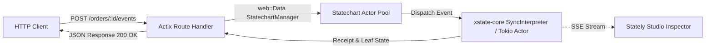

# Actix-web Integration

Integrate `xstate-statemachine` with [**Actix-web**](https://actix.rs/) (40M+ downloads), Rust's battle-tested, high-performance web framework.

---

## 🎯 Architecture Overview



You can run statecharts in Actix-web in two modes:
1. **Per-Request Stateless Execution:** Load state from database (`xstate-persistence`), process the HTTP event, persist the new snapshot, and respond.
2. **Long-Lived Resident Actors:** Keep statechart actors in-memory wrapped in `web::Data`, allowing instant transitions and live WebSocket/SSE streaming.

---

## 📦 Dependencies

In your `Cargo.toml`:

```toml
[dependencies]
actix-web = "4"
serde = { version = "1.0", features = ["derive"] }
serde_json = "1.0"
tokio = { version = "1", features = ["full"] }
xstate-statemachine = { version = "0.1", features = ["tokio", "persistence", "inspect"] }
```

---

## 🚀 Complete Example: Order Statechart Service

### 1. Define the Statechart

```rust
use std::sync::Arc;
use actix_web::{web, App, HttpResponse, HttpServer, Responder, post, get};
use serde::{Deserialize, Serialize};
use xstate_statemachine::prelude::*;
use xstate_statemachine::tokio::{spawn, Options, Interpreter};

const ORDER_MACHINE: &str = r#"{
    "id": "order",
    "initial": "draft",
    "context": {"total": 0, "items": []},
    "states": {
        "draft": {
            "on": {
                "SUBMIT": "processing",
                "CANCEL": "cancelled"
            }
        },
        "processing": {
            "on": {
                "PAYMENT_CONFIRMED": "paid",
                "PAYMENT_FAILED": "payment_failed"
            }
        },
        "paid": {"type": "final"},
        "payment_failed": {
            "on": {"RETRY": "processing", "CANCEL": "cancelled"}
        },
        "cancelled": {"type": "final"}
    }
}"#;
```

### 2. Statechart Application State (`web::Data`)

```rust
pub struct AppState {
    pub machine: Arc<Machine>,
    pub logic: Arc<MachineLogic>,
    pub actors: dashmap::DashMap<String, Interpreter>,
}

impl AppState {
    pub fn new() -> Result<Self, Box<dyn std::error::Error>> {
        let machine = Arc::new(Machine::from_json(ORDER_MACHINE)?);
        let logic = Arc::new(MachineLogic::dynamic());
        Ok(Self {
            machine,
            logic,
            actors: dashmap::DashMap::new(),
        })
    }

    pub fn get_or_create(&self, order_id: &str) -> Result<Interpreter, Box<dyn std::error::Error>> {
        if let Some(actor) = self.actors.get(order_id) {
            return Ok(actor.clone());
        }
        let actor = spawn(
            (*self.machine).clone(),
            (*self.logic).clone(),
            Options::default(),
        )?;
        self.actors.insert(order_id.to_string(), actor.clone());
        Ok(actor)
    }
}
```

### 3. Route Handlers

```rust
#[derive(Deserialize)]
pub struct SendEventRequest {
    pub event: String,
    pub payload: Option<serde_json::Value>,
}

#[derive(Serialize)]
pub struct StateResponse {
    pub order_id: String,
    pub status: String,
    pub current_states: Vec<String>,
}

#[post("/orders/{id}/events")]
async fn handle_event(
    path: web::Path<String>,
    req: web::Json<SendEventRequest>,
    data: web::Data<AppState>,
) -> impl Responder {
    let order_id = path.into_inner();
    let actor = match data.get_or_create(&order_id) {
        Ok(a) => a,
        Err(e) => return HttpResponse::InternalServerError().body(e.to_string()),
    };

    let mut event = Event::new(&req.event);
    if let Some(payload) = &req.payload {
        event = event.with_payload(payload.clone());
    }

    match actor.send_and_wait(event).await {
        Ok(receipt) => {
            let view = actor.view();
            HttpResponse::Ok().json(StateResponse {
                order_id,
                status: view.status.as_str().to_string(),
                current_states: view.state_ids,
            })
        }
        Err(err) => HttpResponse::BadRequest().json(serde_json::json!({
            "error": err.to_string(),
        })),
    }
}

#[get("/orders/{id}/state")]
async fn get_state(
    path: web::Path<String>,
    data: web::Data<AppState>,
) -> impl Responder {
    let order_id = path.into_inner();
    match data.get_or_create(&order_id) {
        Ok(actor) => {
            let view = actor.view();
            HttpResponse::Ok().json(StateResponse {
                order_id,
                status: view.status.as_str().to_string(),
                current_states: view.state_ids,
            })
        }
        Err(e) => HttpResponse::InternalServerError().body(e.to_string()),
    }
}
```

### 4. Application Entry Point

```rust
#[actix_web::main]
async fn main() -> std::io::Result<()> {
    tracing_subscriber::fmt::init();
    let app_state = web::Data::new(AppState::new().expect("Failed to initialize statechart"));

    println!("⚡ Actix-web Statechart Server running on http://127.0.0.1:8080");

    HttpServer::new(move || {
        App::new()
            .app_data(app_state.clone())
            .service(handle_event)
            .service(get_state)
    })
    .bind(("127.0.0.1", 8080))?
    .run()
    .await
}
```

---

## 🧪 Testing with `actix_web::test`

```rust
#[actix_web::test]
async fn test_order_transition_flow() {
    let state = web::Data::new(AppState::new().unwrap());
    let app = actix_web::test::init_service(
        App::new().app_data(state.clone()).service(handle_event)
    ).await;

    let req = actix_web::test::TestRequest::post()
        .uri("/orders/order-101/events")
        .set_json(&SendEventRequest {
            event: "SUBMIT".into(),
            payload: None,
        })
        .to_request();

    let resp: StateResponse = actix_web::test::call_and_read_body_json(&app, req).await;
    assert_eq!(resp.current_states, vec!["order.processing"]);
}
```
