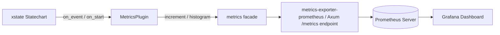

# Prometheus & Metrics Integration

Production metrics, transition counters, and latency histograms via the [**metrics**](https://crates.io/crates/metrics) facade (25M+ downloads) and **Prometheus**.

---

## 🎯 Architecture: Metrics Collection Pipeline



---

## 📦 Dependencies

```toml
[dependencies]
xstate-statemachine = { version = "0.1", features = ["observability"] }
metrics = "0.24"
metrics-exporter-prometheus = "0.16"
```

---

## 🚀 Setup & Prometheus Scrape Endpoint

```rust
use std::sync::Arc;
use metrics_exporter_prometheus::PrometheusBuilder;
use xstate_statemachine::prelude::*;
use xstate_statemachine::plugins::MetricsPlugin;

fn main() -> Result<(), Box<dyn std::error::Error>> {
    // 1. Install Prometheus recorder
    let builder = PrometheusBuilder::new();
    let handle = builder.install_recorder()?;

    // 2. Attach MetricsPlugin to your statechart
    let machine = Machine::from_json(ORDER_JSON)?;
    let mut interp = SyncInterpreter::new(machine, MachineLogic::dynamic());
    interp.plugin(Arc::new(MetricsPlugin::new()));

    interp.start()?;
    interp.send("CHECKOUT")?;
    interp.send("PAY")?;

    // 3. Render Prometheus text format for HTTP /metrics endpoint
    let metrics_text = handle.render();
    println!("--- Scraped Prometheus Metrics ---\n{metrics_text}");

    Ok(())
}
```

### Exposed Metrics

* `xstate_transitions_total{machine="order", from="cart", to="checkout"}`
* `xstate_events_received_total{machine="order", event="PAY"}`
* `xstate_step_duration_seconds_bucket{machine="order", le="0.0001"}`
* `xstate_dropped_events_total{machine="order", reason="stopped"}`
