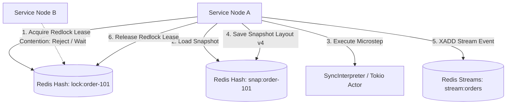

# Redis & Redis Streams Integration

Distributed state persistence, Redlock distributed locking, and event streaming with [**redis-rs**](https://crates.io/crates/redis) (35M+ downloads).

---

## 🎯 Architecture: Multi-Node Distributed Fleet



`xstate-persistence` and `xstate-eda` provide turnkey Redis backends compatible with Python [`xstate-statemachine[redis]`](https://pypi.org/project/xstate-statemachine/). A Redis store populated by Python can be read and updated by Rust with zero data transformation.

---

## 📦 Dependencies

```toml
[dependencies]
xstate-statemachine = { version = "0.1", features = ["persistence", "redis", "redis-streams"] }
```

---

## 🚀 Usage: Redis Persistence Store

```rust
use xstate_statemachine::prelude::*;
use xstate_statemachine::persistence::{RedisStore, RedisStoreOptions, persisted, PersistedOptions};

#[tokio::main]
async fn main() -> Result<(), Box<dyn std::error::Error>> {
    let options = RedisStoreOptions::default();
    let store = RedisStore::connect("redis://127.0.0.1:6379", options).await?;

    let machine = Machine::from_json(ORDER_JSON)?;
    let logic = MachineLogic::dynamic();

    // Executes inside a distributed Redlock with automatic lease renewal
    let states = persisted(
        &store,
        "order-9001",
        &machine,
        &logic,
        &PersistedOptions::default(),
        |interp, _| {
            interp.send("SHIP")?;
            Ok(interp.state_ids())
        },
    )?;

    println!("Order transitioned to: {:?}", states);
    Ok(())
}
```
