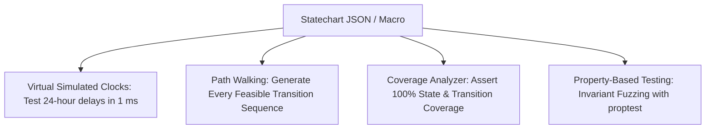

# Testing & Proptest Test Harness

Comprehensive test methodologies for statecharts: simulated virtual clocks, path walking, transition coverage, and property-based fuzzing with [**proptest**](https://crates.io/crates/proptest).

---

## 🎯 Architecture: Testing Dimensions



`xstate-statemachine` provides a dedicated test crate (`xstate-testing`) and testing utilities designed to make statechart validation deterministic, fast, and exhaustive.

---

## 📦 Dependencies

```toml
[dev-dependencies]
xstate-statemachine = { version = "0.1", features = ["testing"] }
proptest = "1.6"
```

---

## ⏱️ Virtual Simulated Clocks (`SimulatedClock`)

Never use `std::thread::sleep` or `tokio::time::sleep` in unit tests. With [`SimulatedClock`](https://docs.rs/xstate-core/latest/xstate_core/clock/struct.SimulatedClock.html), you advance simulated time deterministically:

```rust
use std::time::Duration;
use xstate_statemachine::core::clock::SimulatedClock;
use xstate_statemachine::prelude::*;

#[test]
fn test_timer_expiration_in_one_millisecond() -> Result<(), Box<dyn std::error::Error>> {
    let machine = Machine::from_json(r#"{
        "id": "door",
        "initial": "opened",
        "states": {
            "opened": {
                "after": {
                    "30000": "closed"
                }
            },
            "closed": {}
        }
    }"#)?;

    let clock = SimulatedClock::new();
    let mut interp = SyncInterpreter::new_with_clock(
        machine,
        MachineLogic::dynamic(),
        clock.clone()
    );

    interp.start()?;
    assert_eq!(interp.state_ids(), ["door.opened"]);

    // Advance virtual clock by 30 seconds instantly!
    clock.advance(Duration::from_secs(30));
    interp.tick()?;

    assert_eq!(interp.state_ids(), ["door.closed"]);
    Ok(())
}
```

---

## 🚶 Path Walking & State Coverage

Generate test walks that visit every valid state and transition in your machine:

```rust
use xstate_statemachine::prelude::*;
use xstate_testing::{shortest_paths, assert_coverage};

#[test]
fn test_exhaustive_path_coverage() -> Result<(), Box<dyn std::error::Error>> {
    let machine = Machine::from_json(ORDER_JSON)?;
    let paths = shortest_paths(&machine)?;

    for path in paths {
        let mut interp = SyncInterpreter::new(machine.clone(), MachineLogic::dynamic());
        interp.start()?;

        for step in path.steps {
            interp.send(step.event)?;
            assert_eq!(interp.state_ids(), step.expected_states);
        }
    }

    Ok(())
}
```

---

## 🎲 Property-Based Invariant Fuzzing (`proptest`)

Verify that no sequence of random events can ever violate core business invariants (e.g. negative balances, deadlocks, or illegal state configurations):

```rust
use proptest::prelude::*;
use xstate_statemachine::prelude::*;

proptest! {
    #[test]
    fn machine_never_reaches_illegal_state(
        events in proptest::collection::vec(
            prop_oneof![
                Just("CLICK"),
                Just("RESET"),
                Just("SUBMIT"),
                Just("CANCEL"),
                Just("RANDOM_EVENT"),
            ],
            1..100
        )
    ) {
        let machine = Machine::from_json(MY_MACHINE).unwrap();
        let mut interp = SyncInterpreter::new(machine, MachineLogic::dynamic());
        interp.start().unwrap();

        for event in events {
            let _ = interp.send(event);

            // Invariant: If machine is stopped, it must be in a terminal state
            if interp.is_done() {
                assert!(interp.state_ids().contains(&"terminal".to_string()));
            }
        }
    }
}
```
