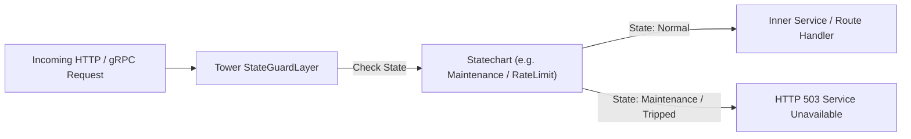

# Tower Middleware & Service Integration

Build composable, state-driven middleware pipelines using [**Tower**](https://crates.io/crates/tower) (70M+ downloads), the foundational networking and service abstraction for **Axum**, **Tonic (gRPC)**, and **Hyper**.

---

## 🏗️ Architecture: The Statechart Guard Layer



With Tower, you can use statecharts to manage:
1. **System Health & Maintenance Gates:** Allow traffic only when the statechart is in `healthy`; immediately return 503 when in `maintenance` or `draining`.
2. **Circuit Breaking:** Transition to `open` on repeated errors, shedding load without hitting upstream backends.
3. **Session & Auth State Verification:** Guard endpoints based on tenant subscription or onboarding lifecycle state.

---

## 📦 Dependencies

```toml
[dependencies]
tower = { version = "0.5", features = ["util"] }
http = "1"
xstate-statemachine = { version = "0.1", features = ["tokio"] }
```

---

## 🛠️ Implementation: `StateGuardLayer`

A Tower Layer that inspects a running statechart actor before forwarding requests to the inner service:

```rust
use std::future::Future;
use std::pin::Pin;
use std::sync::Arc;
use std::task::{Context, Poll};
use http::{Request, Response, StatusCode};
use tower::{Layer, Service};
use xstate_statemachine::prelude::*;
use xstate_statemachine::tokio::Interpreter;

/// Tower Layer enforcing that the statechart must be in `allowed_state` to proceed.
#[derive(Clone)]
pub struct StateGuardLayer {
    actor: Interpreter,
    allowed_state: &'static str,
}

impl StateGuardLayer {
    pub fn new(actor: Interpreter, allowed_state: &'static str) -> Self {
        Self { actor, allowed_state }
    }
}

impl<S> Layer<S> for StateGuardLayer {
    type Service = StateGuardService<S>;

    fn layer(&self, inner: S) -> Self::Service {
        StateGuardService {
            inner,
            actor: self.actor.clone(),
            allowed_state: self.allowed_state,
        }
    }
}

/// Tower Service executing the state check before forwarding.
#[derive(Clone)]
pub struct StateGuardService<S> {
    inner: S,
    actor: Interpreter,
    allowed_state: &'static str,
}

impl<S, ReqBody, ResBody> Service<Request<ReqBody>> for StateGuardService<S>
where
    S: Service<Request<ReqBody>, Response = Response<ResBody>> + Clone + Send + 'static,
    S::Future: Send + 'static,
    ReqBody: Send + 'static,
    ResBody: Default + Send + 'static,
{
    type Response = Response<ResBody>;
    type Error = S::Error;
    type Future = Pin<Box<dyn Future<Output = Result<Self::Response, Self::Error>> + Send>>;

    fn poll_ready(&mut self, cx: &mut Context<'_>) -> Poll<Result<(), Self::Error>> {
        self.inner.poll_ready(cx)
    }

    fn call(&mut self, req: Request<ReqBody>) -> Self::Future {
        let view = self.actor.view();
        let is_allowed = view.state_ids.iter().any(|s| s == self.allowed_state);

        if !is_allowed {
            let res = Response::builder()
                .status(StatusCode::SERVICE_UNAVAILABLE)
                .body(ResBody::default())
                .unwrap();
            return Box::pin(async move { Ok(res) });
        }

        let fut = self.inner.call(req);
        Box::pin(async move { fut.await })
    }
}
```

---

## 🚀 Composing with Axum or Hyper

```rust
use axum::{routing::get, Router};
use xstate_statemachine::prelude::*;
use xstate_statemachine::tokio::{spawn, Options};

#[tokio::main]
async fn main() -> Result<(), Box<dyn std::error::Error>> {
    // 1. Define system lifecycle machine
    let machine = Machine::from_json(r#"{
        "id": "maintenance",
        "initial": "operational",
        "states": {
            "operational": {"on": {"START_MAINTENANCE": "maintenance"}},
            "maintenance": {"on": {"RESUME": "operational"}}
        }
    }"#)?;

    let actor = spawn(machine, MachineLogic::dynamic(), Options::default())?;

    // 2. Wrap Axum router with StateGuardLayer
    let app = Router::new()
        .route("/api/v1/resource", get(|| async { "Healthy data!" }))
        .layer(StateGuardLayer::new(actor.clone(), "maintenance.operational"));

    // 3. Serve requests
    let listener = tokio::net::TcpListener::bind("0.0.0.0:3000").await?;
    axum::serve(listener, app).await?;
    Ok(())
}
```
