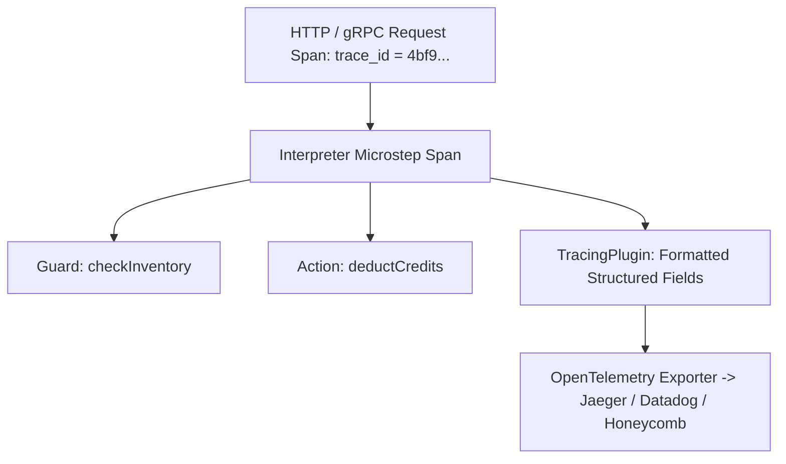

# Tracing & OpenTelemetry Diagnostics

Distributed tracing, span propagation, and structured diagnostics with [**tracing**](https://crates.io/crates/tracing) (150M+ downloads) and **OpenTelemetry**.

---

## 🎯 Architecture: Distributed Tracing Spans



`xstate-statemachine` uses the `tracing` facade throughout its codebase under target `xstate`. When an event is processed, `TracingPlugin` emits structured fields without performing any heap allocations on the fast path.

---

## 📦 Dependencies

```toml
[dependencies]
tracing = "0.1"
tracing-subscriber = { version = "0.3", features = ["env-filter", "json"] }
tracing-opentelemetry = "0.28"
xstate-statemachine = "0.1"
```

---

## 🚀 Setup: Formatted Structured Logging

```rust
use std::sync::Arc;
use tracing_subscriber::{layer::SubscriberExt, util::SubscriberInitExt, EnvFilter};
use xstate_statemachine::prelude::*;

fn main() -> Result<(), Box<dyn std::error::Error>> {
    // 1. Initialize structured logging layer
    tracing_subscriber::registry()
        .with(EnvFilter::new("info,xstate=debug"))
        .with(tracing_subscriber::fmt::layer().pretty())
        .init();

    // 2. Attach TracingPlugin to your statechart
    let machine = Machine::from_json(ORDER_JSON)?;
    let mut interp = SyncInterpreter::new(machine, MachineLogic::dynamic());
    interp.plugin(Arc::new(TracingPlugin));

    interp.start()?;
    interp.send("SUBMIT")?;
    interp.send("APPROVE")?;

    Ok(())
}
```

### JSON Output for Production (CloudWatch / Datadog)

To emit machine-readable JSON logs in Kubernetes or AWS:

```rust
tracing_subscriber::registry()
    .with(EnvFilter::from_default_env())
    .with(tracing_subscriber::fmt::layer().json())
    .init();
```

Emitted JSON record:

```json
{
  "timestamp": "2026-11-10T02:50:12.348210Z",
  "level": "INFO",
  "target": "xstate",
  "fields": {
    "machine": "order",
    "event": "APPROVE",
    "changed": true,
    "unhandled": false,
    "actions": ["sendInvoice", "notifyCustomer"],
    "states": ["order.approved"],
    "status": "running",
    "message": "event processed"
  }
}
```

---

## 🔒 Automated Credential Redaction

`TracingPlugin` and `TransitionLogObserver` automatically mask sensitive fields in context and event payloads:

```rust
use xstate_statemachine::prelude::*;

// DEFAULT_REDACT_KEYS matches: password, secret, token, api_key, authorization, credential, card, cvv
let payload = serde_json::json!({
    "user_id": 42,
    "api_token": "sk_live_992384729384",
    "credit_card": "4111-2222-3333-4444"
});

let clean = redact(&payload, &DEFAULT_REDACT_KEYS);
assert_eq!(clean["api_token"], "***");
assert_eq!(clean["credit_card"], "***");
assert_eq!(clean["user_id"], 42);
```

---

## 🌐 OpenTelemetry & Jaeger Export

```rust
use opentelemetry::global;
use tracing_opentelemetry::OpenTelemetryLayer;
use tracing_subscriber::{layer::SubscriberExt, util::SubscriberInitExt};

pub fn init_telemetry() {
    let tracer = opentelemetry_otlp::new_pipeline()
        .tracing()
        .with_exporter(opentelemetry_otlp::new_exporter().tonic())
        .install_batch(opentelemetry_sdk::runtime::Tokio)
        .expect("Failed to initialize OTLP tracer");

    tracing_subscriber::registry()
        .with(OpenTelemetryLayer::new(tracer))
        .with(tracing_subscriber::fmt::layer())
        .init();
}
```
