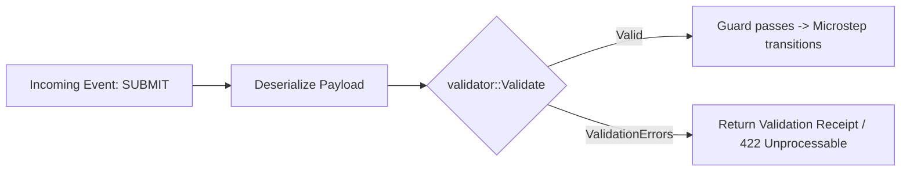

# Schema Validation (Validator & Garde)

Enforce rigorous schema invariants, data integrity, and payload validation using [**validator**](https://crates.io/crates/validator) (20M+ downloads) or **garde**.

This guide covers the Rust counterpart of Python's `pydantic` integration (`xstate-statemachine[pydantic]`).

---

## 🎯 Architecture: Validation Guards



In `xstate-statemachine`, validation can be applied at two levels:
1. **Event Payload Validation:** Validate incoming request parameters before dispatching into the statechart.
2. **Context Invariant Validation:** Enforce that context properties (e.g. email formats, positive currency amounts, non-empty collections) remain valid after every action assignment.

---

## 📦 Dependencies

```toml
[dependencies]
validator = { version = "0.19", features = ["derive"] }
serde = { version = "1.0", features = ["derive"] }
serde_json = "1.0"
xstate-statemachine = "0.1"
```

---

## 🛠️ Implementation: Validated Context & Guards

### 1. Define Validated Structs

```rust
use serde::{Deserialize, Serialize};
use validator::{Validate, ValidationError};

#[derive(Debug, Clone, Serialize, Deserialize, Validate)]
pub struct OrderContext {
    #[validate(length(min = 1, message = "Customer ID cannot be empty"))]
    pub customer_id: String,

    #[validate(email(message = "Invalid notification email"))]
    pub email: String,

    #[validate(range(min = 100, max = 1_000_000, message = "Amount must be between $1 and $10,000"))]
    pub amount_cents: i64,
}

#[derive(Debug, Clone, Serialize, Deserialize, Validate)]
pub struct PaymentPayload {
    #[validate(length(equal = 3, message = "Currency must be 3-letter ISO code"))]
    pub currency: String,

    #[validate(credit_card(message = "Invalid card number"))]
    pub card_number: String,
}
```

### 2. Statechart with Validation Guards

```rust
use xstate_statemachine::prelude::*;

pub fn build_validated_logic() -> MachineLogic {
    MachineLogic::dynamic()
        .guard("isValidPayment", |_ctx, event, _params| {
            // Extract event payload and validate against schema
            if let Some(payload_val) = &event.payload {
                let payload: Result<PaymentPayload, _> = serde_json::from_value(payload_val.clone());
                match payload {
                    Ok(p) => p.validate().is_ok(),
                    Err(_) => false,
                }
            } else {
                false
            }
        })
        .guard("isValidContext", |ctx, _event, _params| {
            // Validate entire machine context
            let parsed: Result<OrderContext, _> = serde_json::from_value(ctx.clone());
            match parsed {
                Ok(c) => c.validate().is_ok(),
                Err(_) => false,
            }
        })
}
```

---

## 🚀 Pre-Transition Validation Hook Pattern

You can encapsulate validation into an ergonomic dispatcher function:

```rust
pub fn send_validated_event<T: Validate + for<'de> serde::Deserialize<'de>>(
    interp: &mut SyncInterpreter,
    event_name: &'static str,
    payload: serde_json::Value,
) -> Result<Receipt, Box<dyn std::error::Error>> {
    // 1. Validate payload schema first
    let typed_payload: T = serde_json::from_value(payload.clone())?;
    typed_payload.validate()?;

    // 2. Dispatch valid event to statechart
    let event = Event::new(event_name).with_payload(payload);
    let receipt = interp.send(event)?;
    Ok(receipt)
}
```
