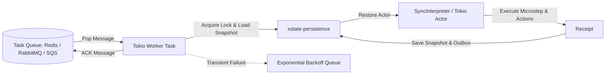

# Background Workers & Task Queues

Drive asynchronous, distributed statechart workflows using **Tokio worker pools** and background task queues (e.g. **Apalis** / Redis queue workers).

This guide covers the Rust counterpart of Python's Celery integration (`xstate-statemachine[celery]`).

---

## 🎯 Architecture: Persistent Worker Pipeline



---

## 📦 Dependencies

```toml
[dependencies]
tokio = { version = "1", features = ["full"] }
xstate-statemachine = { version = "0.1", features = ["tokio", "persistence", "sqlite"] }
serde = { version = "1.0", features = ["derive"] }
serde_json = "1.0"
```

---

## 🚀 Implementation: Durable Tokio Task Consumer Loop

```rust
use std::sync::Arc;
use tokio::sync::mpsc;
use xstate_statemachine::prelude::*;
use xstate_statemachine::persistence::{SqliteStore, SqliteStoreOptions, persisted, PersistedOptions};

#[derive(Debug)]
pub struct BackgroundTask {
    pub workflow_id: String,
    pub event_name: String,
    pub payload: serde_json::Value,
}

pub async fn run_worker_pool(
    mut queue_rx: mpsc::Receiver<BackgroundTask>,
    store: Arc<SqliteStore>,
    machine: Arc<Machine>,
    logic: Arc<MachineLogic>,
) {
    println!("⚙️ Background Statechart Worker Pool active...");

    while let Some(task) = queue_rx.recv().await {
        let store = store.clone();
        let machine = machine.clone();
        let logic = logic.clone();

        tokio::spawn(async move {
            let res = persisted(
                &*store,
                &task.workflow_id,
                &*machine,
                &*logic,
                &PersistedOptions::default(),
                |interp, _| {
                    let ev = Event::new(&task.event_name).with_payload(task.payload);
                    let receipt = interp.send(ev)?;
                    Ok(receipt.state_ids())
                },
            );

            match res {
                Ok(new_states) => {
                    tracing::info!(
                        workflow = %task.workflow_id,
                        states = ?new_states,
                        "Workflow step processed successfully"
                    );
                }
                Err(err) => {
                    tracing::error!(
                        workflow = %task.workflow_id,
                        error = %err,
                        "Failed to process background workflow step"
                    );
                }
            }
        });
    }
}
```

---

## ⏱️ Durable Timer & Deadline Worker (`DueTimerScanner`)

In long-running business processes, transitions may be triggered after minutes, days, or months (`"after": {"86400000": "escalated"}`).

`xstate-persistence` includes a built-in background scanner that polls durable deadlines across SQLite or PostgreSQL:

```rust
use std::sync::Arc;
use std::time::Duration;
use xstate_statemachine::persistence::{SqliteStore, timers::DueTimerScanner};

#[tokio::main]
async fn main() -> Result<(), Box<dyn std::error::Error>> {
    let store = Arc::new(SqliteStore::open_default("workflows.db")?);

    // Spawn scanner that checks for expired deadlines every second
    let scanner = DueTimerScanner::new(store.clone(), Duration::from_secs(1));
    tokio::spawn(async move {
        scanner.run().await;
    });

    println!("⏰ Durable timer scanner running in background...");
    tokio::signal::ctrl_c().await?;
    Ok(())
}
```
